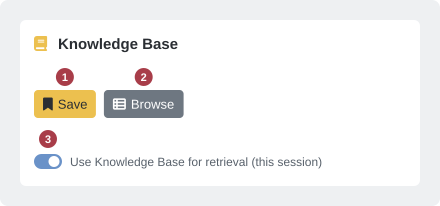

# Knowledge Base

Save chat sessions and import documents into one searchable library.

The Knowledge Base holds conversations and documents: conversation transcripts, PDFs, Office files, Markdown, and source code. The **Library** tab of the sidebar shows all of it, and every app that searches the Knowledge Base searches all of it.

1. **Save**: saves the current conversation to the Knowledge Base.
2. **Browse**: opens the **Library** tab of the sidebar.
3. **Use Knowledge Base for retrieval (this session)**: lets the model search the Knowledge Base while answering.

**Ways to add content:**

1. **Save the current chat session**: the **Save** button in the Knowledge Base panel of the sidebar saves the current conversation to the Knowledge Base.
2. **Keep a document of the work screen**: under a document on the [work screen](../basic-usage/web-interface.md#work-screen) in one of the formats below, **Keep in the Library** imports it as the version shown.
3. **Keep this conversation as a document**: **Keep this conversation** in the **Library** tab puts the conversation on the work screen as a Markdown document: the title, the app, the model and the date, then each turn under a heading. Files of the conversation are named, not kept; system prompts, thinking and tool records are left out. Check it there, and keep it with **Keep in the Library**.
4. **Import a file**: open the **Library** tab of the sidebar and click **Import file** to upload a file in one of the formats below. The file is extracted, split into sections, and stored as one entry that you can search, view, and rename. The file itself is kept in `~/monadic/library`, outside the shared folder; it is deleted with its entry, unless another entry was made from the same file.

**Supported import formats:**

| Format | Extensions |
|---|---|
| Markdown | `.md`, `.markdown`, `.mdx` |
| Source code | `.rb`, `.py`, `.js` / `.ts`, `.go`, `.java`, `.kt`, `.swift`, `.rs`, `.c` / `.cpp`, `.cs`, `.php`, `.sh`, `.sql`, and others |
| PDF | `.pdf` |
| Office | `.docx`, `.xlsx`, `.pptx` |

The text and tables of PDFs are extracted. With the Knowledge Base Quality Pack installed, layout analysis and OCR are used; without it, no text is extracted from image-only PDFs.

A chat that [hides words](../advanced-topics/anonymization.md) cannot be saved, but it can still search the Knowledge Base.

**Other features:**

- **Saving again updates the entry**: saving the same chat session again updates its entry instead of creating another one. The dialog then reads "Update Conversation in Knowledge Base", with an **Update** button and a note. The link between the session and the entry ends on Reset, on switching apps, or when the entry is deleted in Browse.
- **Suggested titles**: when you first save a conversation, the title field is filled in by the current provider's model, based on the conversation. You can type over it. The suggestion is kept, so closing and reopening the dialog does not ask the model again.
- **Rename**: open the Conversation Viewer, click the pencil icon next to the title, edit, and save.
- **Recent saves and counts**: the sidebar shows the most recent saves and the total counts. The Library tab can be searched and sorted.
- **Conversation Viewer**: click a row to see every message of the entry. The system prompt is folded.
- **Retrieval in apps**: turn on **Use Knowledge Base for retrieval (this session)** in the Knowledge Base panel to let the model search the Knowledge Base while answering. The passages it read are put on the [work screen](../basic-usage/web-interface.md#work-screen) and listed under its reply, with how many it cited; a passage it cites opens from its link in the reply. The switch is off by default and is remembered for each app: turning it on in one app does not turn it on in another. Live Conversation uses its own **Search and compute** switch instead.
- **Knowledge Base badge**: the conversation header shows a green "Knowledge Base" badge while the retrieval switch is on and the session can read from the Knowledge Base.

?> The Knowledge Base converts text into vectors on your computer and stores them in Qdrant, so importing and searching need no API key. See [Vector Database](../docker-integration/vector-database.md).
