# Monadic Chat Console Panel

## Console Button Items

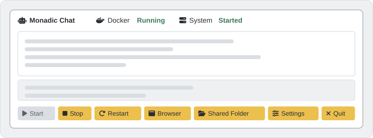

The console panel is the main control interface for Monadic Chat. It displays the current status (Stopped, Starting, Started, etc.) and provides quick access buttons for common operations.

**Start**  
Launch Monadic Chat. The initial startup may take some time due to environment setup on Docker.

**Stop**  
Stop Monadic Chat.

**Restart**  
Restart Monadic Chat.

**Browser**  
Open Monadic Chat in a web browser.
Access URL: [http://localhost:4567](http://localhost:4567)

**Shared Folder**  
Open the folder shared between the host and Docker containers. It can be used for importing and exporting files, and when installing additional apps. See [Shared Folder](../docker-integration/shared-folder.md) for the folder layout and the role of each subfolder (`apps`, `helpers`, `scripts`).

**Settings**  
Open the settings panel described in [Settings Panel](#settings-panel) below.

**Quit**  
Exit Monadic Chat.

## Console Menu Items

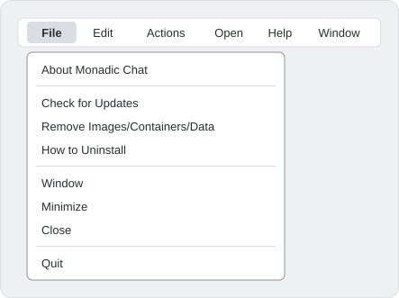

The console has a menu bar with the menus File, Edit, Actions, Open, Help and Window. On macOS, the File menu is shown under the name Monadic Chat. Edit has the usual editing commands, Help opens the documentation, and Window has Minimize, Close and Reload.

### Actions Menu :id=actions-menu

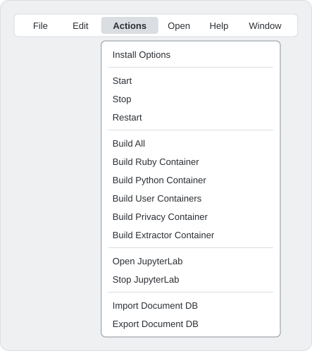

The build commands are available while Monadic Chat is stopped, the JupyterLab commands while it is running, and the Document DB commands while it is stopped.

**Install Options**  
Open the Install Options panel of the settings window, where you can select optional packages (LaTeX, Python libraries, languages for finding names to hide, etc.) to be installed in the service containers.

**Start**  
Launch Monadic Chat. The initial startup may take some time due to environment setup on Docker.

**Stop**  
Stop Monadic Chat.

**Restart**  
Restart Monadic Chat.

**Build All**  
Build the Ruby and Python images without the build cache, download the other prebuilt images, and build your own containers.

**Build Ruby Container**  
Build the image and container (`monadic-chat-ruby-container`) that runs Monadic Chat, without the build cache.

**Build Python Container**  
Build the image and container (`monadic-chat-python-container`) used by the AI agents, without the build cache.

**Build User Containers**  
Build the containers you defined (see [Adding Docker Containers](../advanced-topics/adding-containers.md)), without the build cache. A normal Start does not build them; use this command after adding or changing a definition.

**Build Privacy Container**  
Download the image of the container (`monadic-chat-privacy-container`) that finds names for [Anonymization](../advanced-topics/anonymization.md). Available unless `PRIVACY_FILTER=false` is set.

**Build Extractor Container**  
Download the image of the container (`monadic-chat-extractor-container`) used by the Library Quality Pack. Available when the Quality Pack is installed.

**Open JupyterLab**  
Open JupyterLab ([http://localhost:8889](http://localhost:8889)) in your browser, starting it first when it is not running. See [JupyterLab Integration](../docker-integration/jupyterlab.md) for details.

**Stop JupyterLab**  
Stop JupyterLab.

**Import Document DB**  
Import the entire Document DB (conversations saved to the Library, PDFs, and other Library entries) from a previously exported file in the shared folder. The original files of the Library in the file replace those kept now (a file exported before the originals were included replaces the database only). The chat history is not part of the Document DB and is not changed. A confirmation dialog warns that importing replaces the current database (**Replace and Import**). The accepted filenames are `monadic-qdrant.tar.gz` (plain) or `monadic-qdrant.tar.gz.enc` (encrypted, prompts for the passphrase used at export time). With a wrong passphrase or a damaged file nothing is imported, and the current database stays as it is.

**Export Document DB**  
Export the entire Document DB, with the original files imported into the Library, to the shared folder. A confirmation dialog offers two choices: **Encrypt and Export** (default — prompts for a passphrase of at least 8 characters, encrypts the file with AES-256-GCM and writes `monadic-qdrant.tar.gz.enc`; the passphrase cannot be recovered) or **Export Plain** (writes `monadic-qdrant.tar.gz` unencrypted, with a strong warning that every conversation saved to the Library and every PDF travels in cleartext). The export does not include the [chat history](web-interface.md#chat-history-panel). Use the encrypted form for any export that may leave your machine. The file is written to the shared folder, where code the AI runs can read it: encrypt it, or move a plain export out of the shared folder once it is written.

### Open Menu

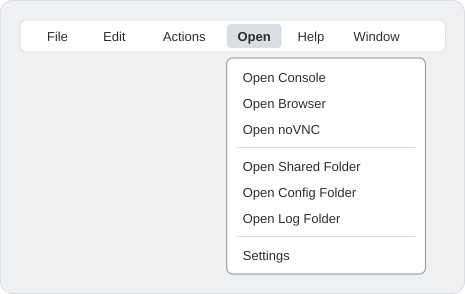

**Open Console**  
Open the Monadic Chat console.

**Open Browser**  
Open the default browser to access Monadic Chat at [http://localhost:4567](http://localhost:4567)

**Open noVNC**  
Open a noVNC viewer window (at `http://localhost:7900`) that shows the screen of the browser running inside the Selenium container. This lets you watch (and interact with) web automation in real time. Available while Monadic Chat is running.

**Open Shared Folder**  
Open the folder shared between the host and Docker containers. It can be used for importing and exporting files, and when installing additional apps. See [Shared Folder](../docker-integration/shared-folder.md) for the folder layout and the role of each subfolder (`apps`, `helpers`, `scripts`).

**Open Config Folder**  
Open the `~/monadic/config` folder. This folder contains configuration files for Monadic Chat. The following files are included:

- `env`: Configuration file (set through the settings window).
- `pysetup.sh`: Script for setting up the Python environment (optional, user-created).
- `rbsetup.sh`: Script for setting up the Ruby environment (optional, user-created).
- `models.json`: Model overrides (optional, user-created). See [Configuration](../reference/configuration.md).
- `TTS_DICT.csv`: The text-to-speech dictionary, copied here when you set one in the settings window.
- `compose.yml`: Docker Compose configuration file (generated when user containers are present).

**Open Log Folder**  
Open the `~/monadic/log` folder. This folder contains log files for Monadic Chat. The following files are included:

- `docker_build.log`: Log file for Docker builds (`docker_build_python.log` for the Python container).
- `docker_startup.log`: Log file for Docker startup.
- `server.log`: Log file for the Monadic Chat server.
- `command.log`: Log file for command execution and code execution.
- `jupyter.log`: Log file for cells added to jupyter notebook.

When `Extra Logging` is enabled in the settings panel, an additional `extra.log` records each chat as streaming JSON objects, from the start of Monadic Chat until it exits. It is intended for debugging.

**Settings**  
Open the Monadic Chat settings window. It is different from the System Settings screen in the web interface.

### File Menu

**About Monadic Chat**  
Shows information about the application version.

**Check for Updates**  
Checks for application updates. When an update is available, a dialog offers **Download & Install**. When the download completes, choose **Restart Now** to install it, or **Later**.

**Remove Images/Containers/Data**  
Removes Monadic Chat's Docker images, containers and volumes (the Library data). Your files in `~/monadic` are kept.

**How to Uninstall**  
Opens the online documentation with complete uninstallation instructions for your operating system.

**Quit**  
Exits the application.

## Settings Panel :id=settings-panel

Click **Save** at the bottom of the sidebar to save your changes (closing the window with unsaved changes asks whether to save them). The settings window is organized into the following sections, accessible from the sidebar: **General**, **System**, **API Keys**, **Voice & Audio**, **Services**, **Install Options**, **Actions**, and **About**.

### General

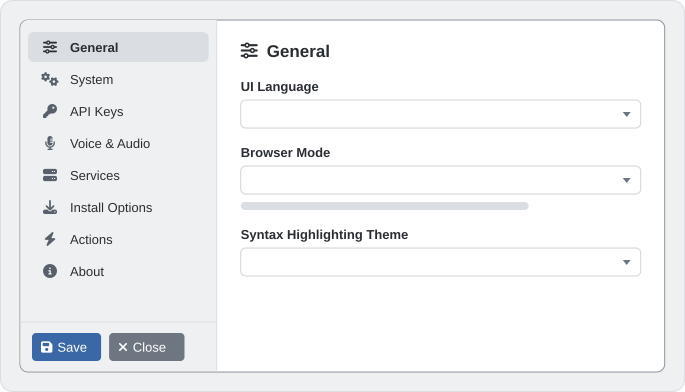

**UI Language**  
Select the display language of the console and settings window.

**Browser Mode**  
Select the browser to use when opening Monadic Chat from the console. "Internal Browser" opens the built-in Electron browser window, while "External Browser" opens your system's default web browser.

**Syntax Highlighting Theme**  
Select the theme for code syntax highlighting. The default is `github-light`.

**Sources the AI can use**  
**The Library, in chats**: when on, the AI consults the [Library](../apps/knowledge-base.md) when you ask for it or it clearly helps, and what it reads is shown on the work screen. 
**Web search, in chats**: when on, the AI searches the web when you ask for it or current information is needed, in apps that search. The search words go to the chat's provider (with DeepSeek, also the address of a page the AI reads), or with Cohere and Ollama to Tavily when its key is set; Live Conversation searches through Tavily. The service that searches charges for it on its key. 
Both are on by default. A change takes effect when Monadic Chat starts again.

### System

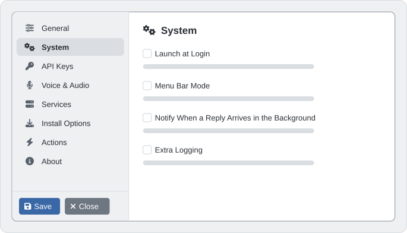

**Launch at Login**  
Start Monadic Chat automatically when you log in to your computer.

**Menu Bar Mode**  
Keep Monadic Chat running in the menu bar instead of showing a console window (macOS).

**Notify When a Reply Arrives in the Background**  
Closing the internal browser window hides it, and the conversation stays as it is. **Open Browser**, or **Show Web UI** in the menu bar (system tray) menu, brings the window back. A reply being generated when the window was closed keeps coming in, and a notification says when it has arrived; click it to bring the window back. The notification never includes the text of the conversation. When the window is hidden, voice input and Live conversations stop and audio playback stops; while it is hidden, no audio plays and the microphone cannot be used. To end the conversation, use **Reset**, choose **Close Web UI** in the menu bar menu, or quit Monadic Chat. Turn this setting off to hide the window without notifications.

**Extra Logging**  
Select whether to enable additional logging. When enabled, API requests and responses are logged in detail. The log file is saved as `~/monadic/log/extra.log`.

### API Keys

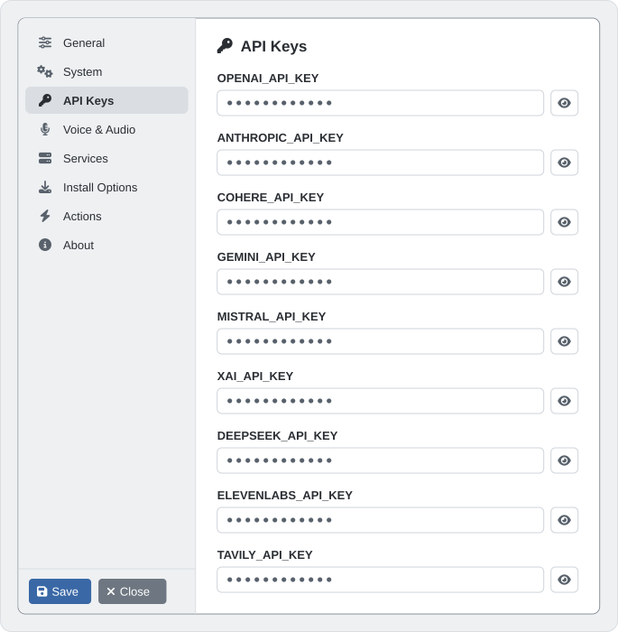

Enter a key for each provider you want to use — configure only the ones you have an account with. OpenAI covers the most ground, since the same key serves its chat models, image generation, speech-to-text and text-to-speech, which makes it the most useful one to start with.

For what each key enables and which apps require it, see [Configuration](../reference/configuration.md#api-keys).

| Setting | Where to get the key |
| --- | --- |
| `OPENAI_API_KEY` | [platform.openai.com](https://platform.openai.com/docs/guides/authentication) |
| `ANTHROPIC_API_KEY` | [console.anthropic.com](https://console.anthropic.com) |
| `COHERE_API_KEY` | [dashboard.cohere.com](https://dashboard.cohere.com) |
| `GEMINI_API_KEY` | [ai.google.dev](https://ai.google.dev/) |
| `MISTRAL_API_KEY` | [console.mistral.ai](https://console.mistral.ai/) |
| `XAI_API_KEY` | [x.ai/api](https://x.ai/api) |
| `DEEPSEEK_API_KEY` | [platform.deepseek.com](https://platform.deepseek.com/) |
| `ELEVENLABS_API_KEY` | [elevenlabs.io/developers](https://elevenlabs.io/developers) |
| `TAVILY_API_KEY` | [tavily.com](https://tavily.com/) |

**Check** under a key sends the key in that field to that field's provider and shows whether the provider accepted it. For providers with a model list, it also lists the provider's default model for each kind of task (chat, code, image, and so on) and whether that model is in the key's list. Apps that name their own model are not listed. A key written as a 1Password reference (`op://...`) is read from 1Password for the check. The key is checked as typed, so it can be checked before saving; checking saves nothing. For `ELEVENLABS_API_KEY` and `TAVILY_API_KEY` only the key is checked.

`TAVILY_API_KEY` is the one key not tied to a single provider: it backs taking in a page's text from **Open URL** as an alternative to Selenium, and web search in apps whose provider has no native search — see the [Provider Capabilities table](../basic-usage/basic-apps.md#provider-capabilities).

### Voice & Audio

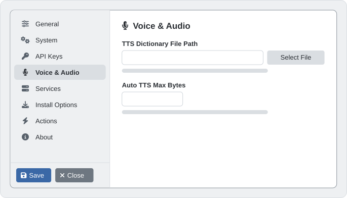

**TTS Dictionary File Path**  
Enter the path to the text-to-speech dictionary file. The dictionary file is in CSV format and contains comma-separated entries of strings to be replaced and the strings to be used for speech synthesis (no header row is required). When using text-to-speech, the strings to be replaced in the text are replaced with the strings for speech synthesis.

**Auto TTS Max Bytes**  
Set the maximum text size (in bytes) for automatic text-to-speech playback in post-completion mode (default: 500). Text exceeding this limit is partially played or skipped.

?> The speech-to-text model is selected in the web UI's Speech panel, not in this settings window. See [Speech Panel](./web-interface.md#speech-settings-panel).

### Services

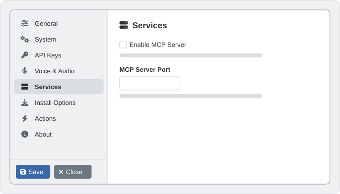

**Enable MCP Server**  
Enable the Model Context Protocol (MCP) server, which exposes Monadic Chat's tools to external AI assistants. See [MCP Integration](../advanced-topics/mcp-integration.md).

**MCP Server Port**  
The network port for the MCP server (default: `3100`). Change it only if the port conflicts with another service.

### Install Options

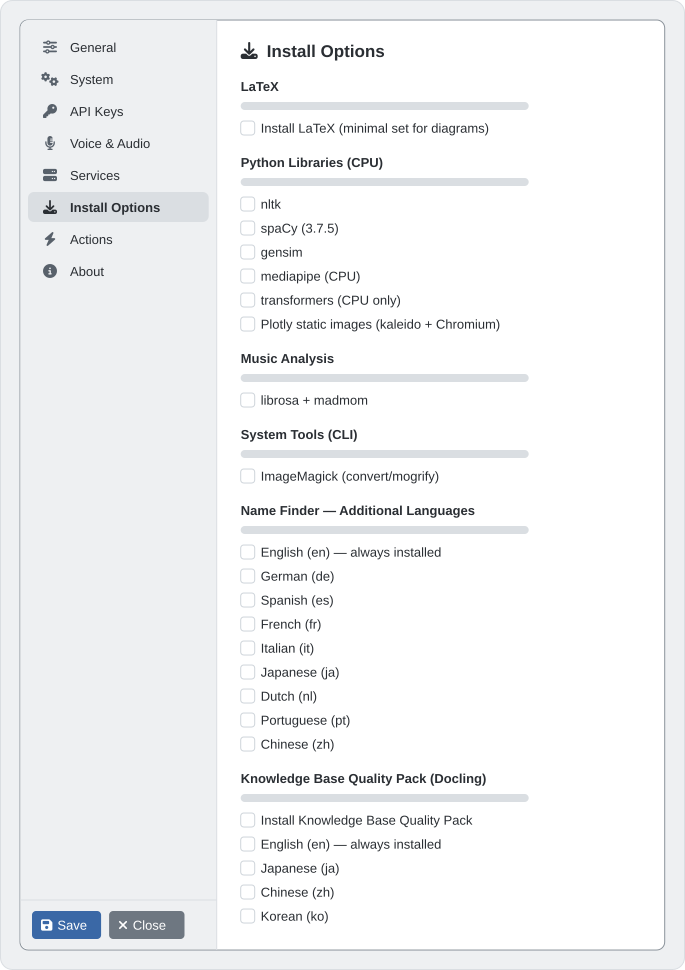

Select optional packages to be installed in the Python container: LaTeX, Python libraries (NLTK, spaCy, gensim, MediaPipe, Transformers), music analysis (librosa, madmom), and system tools (ImageMagick). Saving records the choice but does not rebuild anything: the next Start offers **Rebuild and Start**, or you can rebuild straight away with **Actions → Build Python Container**.

The same panel holds two more groups:

- **Name Finder — Additional Languages**: languages besides English for finding names to hide (German, Spanish, French, Italian, Japanese, Dutch, Portuguese, Chinese). A change takes effect on save, without a rebuild.
- **Library Quality Pack (Docling)**: install the extractor container for higher-quality document import, with its OCR languages (English, Japanese, Chinese, Korean). See [Library](../apps/knowledge-base.md).

### Actions

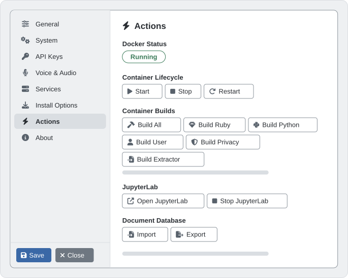

Shows the Docker status and provides the operations of the Actions menu: Start, Stop and Restart; the container builds (containers must be stopped before building); Start and Stop JupyterLab; and Import and Export of the Document DB. Running an action saves your unsaved settings first.

### About

Shows the application version, **Check for Updates**, and links to the homepage and the source code.
