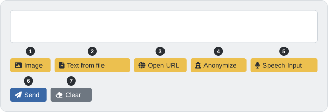
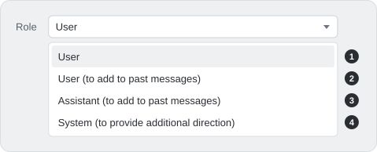
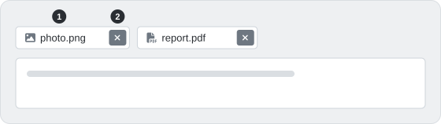
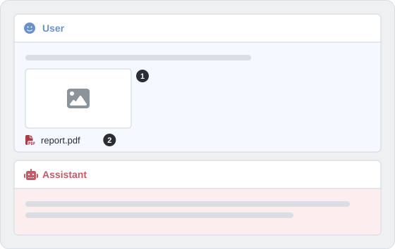
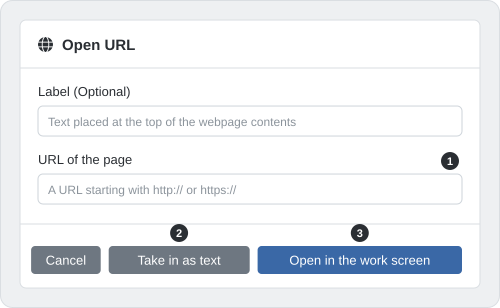
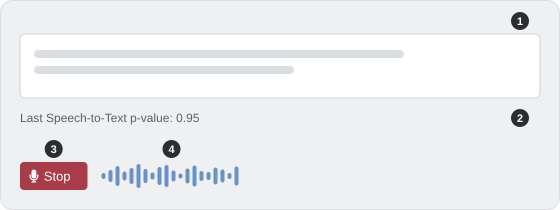
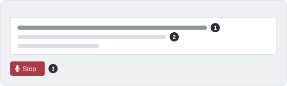

# Message Input

After starting the server and selecting an app and configuring it, click the **Start Session** button to display the following screen.

1. **Image** (or **Attach file**, depending on the model): attaches an image or a PDF to the message. See [Uploading Images](#uploading-images).
2. **Anonymize**: finds names in the message and lets you choose what to hide. See [Anonymize](#anonymize).
3. **Speech Input**: records your voice and writes what you said into the message. See [Speech Input](#speech-input).
4. **Send**: sends the message.
5. **Clear**: empties the message box.

The text of a document and of a web page are taken in from the [work screen](web-interface.md#work-screen): see [Reading Text from Document Files](#reading-text-from-document-files) and [Opening a URL](#reading-text-from-urls).

Enter a message in the text area and click the **Send** button to send it. For voice input, see [Speech Input](#speech-input) below.

?> To chat smoothly with the AI agent using voice input and speech synthesis, turn on **Auto speech** and **Easy submit** in the Interaction panel of the sidebar. They are on by default in the [Voice Chat](../apps/chat-apps.md#voice-chat) app.

?> The **Role** selector sets the role of the message. Normally, select **User**. **User (to add to past messages)** and **Assistant (to add to past messages)** add a message to the conversation without sending it, and **System (to provide additional direction)** adds an instruction. For more information, see the [FAQ](../faq/faq-user-interface.md).

1. **User**: an ordinary message, sent to the AI.
2. **User (to add to past messages)**: added to the conversation as your message, without being sent.
3. **Assistant (to add to past messages)**: added to the conversation as the AI's reply, without being sent.
4. **System (to provide additional direction)**: added to the conversation as an instruction.

## Uploading Images :id=uploading-images

Image uploads are supported for vision-capable models (OpenAI, Anthropic Claude, xAI Grok, Google Gemini, Mistral, Cohere, DeepSeek, and Ollama vision models).

Click **Image** (or **Image/PDF** for models that support PDF) to select an image. Supported formats: JPG, JPEG, PNG, GIF, WebP. Up to 5 images can be attached to a message.

1. The attached file. Click its name to look at it on the work screen before sending (the AI does not see that view; to look at a file together, put it on the work screen, as below).
2. Removes the file from the message.

After uploading the image, its name appears below the message input area with a delete button (×). The image is sent along with your text prompt, and the attachments are cleared once the message is sent.

To look at a file of your computer together with the AI, put it on the work screen with **Put a file** at the top of the work screen, or drop it there; see [Work Screen](web-interface.md#work-screen).

Attached images are downscaled in the browser before sending (long side up to 2000px, short side up to 768px). For full-resolution analysis of fine details, place the image file in the shared folder instead and ask the AI to analyze it — apps with the image-analysis skill read the original file directly and can be asked to use original fidelity.

1. An image, shown in the card of the message it was sent with.
2. A PDF, shown by its name.

## Uploading PDFs :id=uploading-pdfs

Some providers (OpenAI, Anthropic Claude, Google Gemini) support PDF uploads. Click the **Image/PDF** button to attach a PDF file.

?> **Anthropic Claude**: Claude apps support direct PDF upload for AI content recognition.

The PDF is sent with the message it is attached to, and stays in the conversation history for later turns.

## Uploading Extended Document Formats :id=uploading-extended-documents

Some OpenAI models support an extended set of document formats through the File Inputs API. With such a model, the button reads **Attach file** and accepts the following formats in addition to images and PDFs (up to 50 MB; PDFs up to 35 MB):

- Spreadsheets: `.xlsx`, `.csv`
- Documents: `.docx`, `.pptx`, `.txt`, `.md`
- Data/Markup: `.json`, `.html`, `.xml`

Files are cached per session, so the same document is uploaded to OpenAI only once even if it is referenced across multiple turns.

For models using the Responses API, you can also enter a file URL directly in the modal dialog instead of uploading a local file.

## Attaching Video and Audio Files :id=attaching-video-audio

In apps that analyze video or transcribe audio, the **Image** button also takes video files (MP4, M4V, MOV, WebM, MKV, AVI) or audio files (MP3, M4A, WAV, OGG, Opus, FLAC, AAC, WebM). The file is uploaded to the chat's folder and shown below the message box until you send the message. A message can be sent with attached files and no text. The files are listed on the message's card. Video Describer takes videos, and Speech Draft Helper takes audio files.

## Reading Text from Document Files :id=reading-text-from-document-files

Put the document on the [work screen](web-interface.md#work-screen) (**Put a file**, or open it from the shared folder), then click **Text to the message** under it: its text, of the version shown, is added to the message box. Supported file formats include PDF, Word files (`.docx`), Excel files (`.xlsx`), PowerPoint files (`.pptx`), and various text files (`.txt`, `.md`, `.html`, etc). A file you put is kept in the chat's folder (`conversations/…/inputs/`). If the file changes while its text is taken, nothing is added.

## Opening a URL :id=reading-text-from-urls

Click **Open URL** at the top of the [work screen](web-interface.md#work-screen) and enter an address that starts with `http://` or `https://`.

- **Open in the work screen** opens the page in the chat's browser on the [work screen](web-interface.md#work-screen). In an app that has browser tools, or that can look at the work screen, the assistant reads the page from there.
- **Take in as text** reads the page's text into the message box in Markdown format.

1. The address of the page.
2. **Take in as text**: reads the page's text into your message.
3. **Open in the work screen**: opens the page on the work screen.

## Anonymize :id=anonymize

Click **Anonymize** beside the message box to choose words (such as names) that the chat replaces with placeholders in what it sends. Only text is covered: images, file contents, files and pages that code or the browser reads, voice, names not chosen and what was already sent are not. See [Anonymization](../advanced-topics/anonymization.md).

## Speech Input :id=speech-input

?> **Note:** Voice input is supported in Chrome, Edge, and Safari browsers.

To use voice input, click the **Speech Input** button to start voice input, and click the **Stop** button to end voice input. Voice input is not available on iPhone and iPad. After voice input ends, the voice is converted to text via the Speech-to-Text API and displayed in the text area.

[Live Conversation](../apps/chat-apps.md#live-conversation) does not use this path: it has neither text input nor a Speech Input button — the microphone streams continuously while the session is open.

1. What you said is written into the message box.
2. The confidence of the last transcription, when the speech-to-text model returns one.
3. While recording, the **Speech Input** button reads **Stop**. Click it to end the recording.
4. The level of your voice.

With speech-to-text models that report it, **Last Speech-to-Text p-value** is displayed after voice input: the confidence of the transcription, on a scale from 0 to 1. The closer it is to 1, the more confident the result.

## Speech-to-Text Model Selection :id=speech-to-text-model-selection

Select the Speech-to-Text model in the web UI's Speech panel. Models are available from several providers — see the [Speech Panel](/basic-usage/web-interface.md#speech-settings-panel) for them (each option is enabled when its provider's API key is set).

## Realtime Streaming Transcription :id=realtime-streaming-transcription

A streaming mode is available for the **GPT Realtime Whisper ⚡** entry in the Speech-to-Text Model dropdown. The ⚡ glyph indicates models that emit live partial transcripts during recording. When this model is selected, Speech Input behaves differently from the standard batch path:

- As you speak, a live preview of the accumulated transcript appears in the message text area as **grey text**. The preview updates every few hundred milliseconds.
- You can keep typing in the text area while recording. The grey preview follows your typed cursor — your typed text is never overwritten by partials.
- When you click **Stop**, the final transcript is appended to whatever you had in the text area, and the grey preview clears.
- **Easy submit** sends the message once, with the final transcript only — not with intermediate partials.

1. The text you typed.
2. The live preview of what is being heard, in grey.
3. Stops the recording.

**When to use streaming vs batch.** Streaming mode gives immediate visual feedback during long utterances and is well-suited for live note-taking or dictation flows. The standard batch path is more cost-efficient for short utterances, and every other model in the dropdown uses it.

**Cost note.** Realtime transcription is billed per audio minute by OpenAI, at a higher rate than its batch transcription. The other models on the dropdown are billed by their own providers; refer to each provider's pricing page for current rates.

**Provider support.** Realtime streaming transcription is available via OpenAI only. Other STT models on the dropdown use the batch path. This transcription feature is separate from the speech-to-speech conversation in [Live Conversation](../apps/chat-apps.md#live-conversation), which is available for OpenAI, xAI, and Gemini.

!> **Anonymization.** Audio captured by Speech Input is sent as it is to the provider of the Speech-to-Text model you selected; [Anonymization](../advanced-topics/anonymization.md) hides words only in the text a chat sends. If your audio contains words you do not want to send to that provider, type the message instead of dictating it.

## Text-to-Speech Playback

**Playback controls** 
Click the **Start TTS** icon on any AI response to listen to synthesized speech, and **Stop TTS** to halt playback (hover over the icons to see their names). **Cancel Query** stops the response being written and its speech, including speech still being generated.

**Auto speech** 
When **Auto speech** is on in the Interaction panel, AI responses are read aloud automatically. Useful for voice conversations when combined with **Easy submit**.
