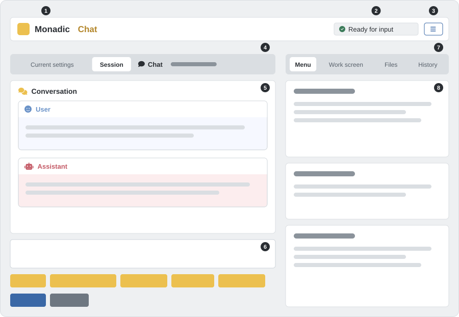
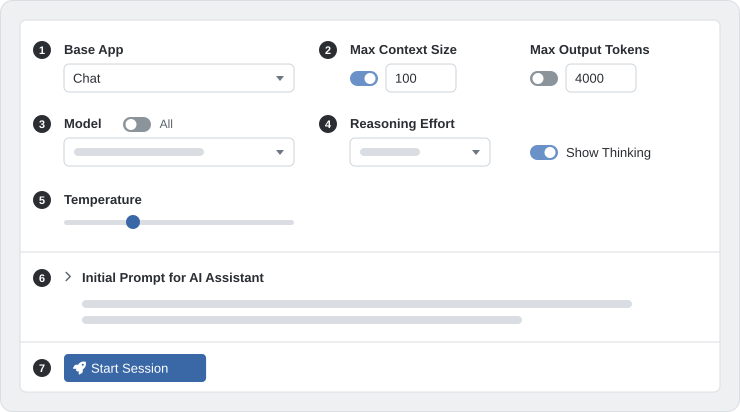
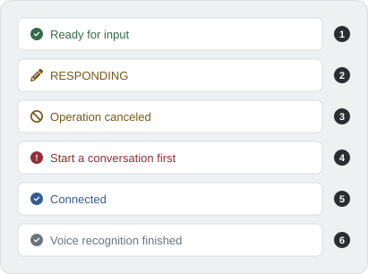
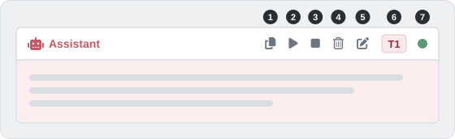
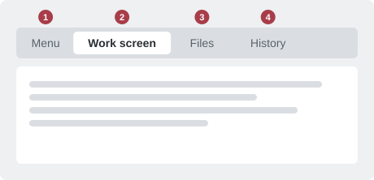
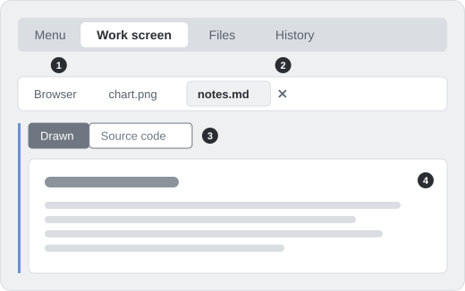
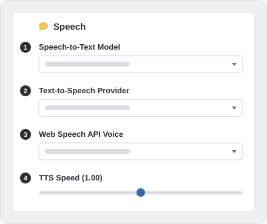

# Monadic Chat Web Interface

1. The name of the app. Click it to reset the chat (the current app is kept).
2. The status: what Monadic Chat is doing now.
3. Shows or hides the sidebar.
4. **Current settings** and **Session**, with the app and model of the session. See [System Settings Screen](#system-settings-screen).
5. The conversation, one card for each message. See [Message Cards](#message-cards).
6. The message box and its buttons. See [Message Input](message-input.md).
7. The sidebar's tabs: **Menu**, **Work screen**, **Files** and **History**.
8. The panels of the chosen tab. See [Sidebar Panels](#info-panel).

The web interface is made up of the conversation area, the message input area, and a set of side panels.

## Browser Modes :id=browser-modes

Monadic Chat supports two different browser modes for accessing its web interface:

### Internal Browser Mode :id=internal-browser-mode

The internal browser mode runs within the Electron desktop application, providing a dedicated window with Monadic Chat-specific features.

In internal browser mode, five buttons appear at the bottom-right corner (hover over each for its name):
- **Zoom In**: Increase the page zoom factor
- **Zoom Out**: Decrease the page zoom factor
- **Reset Zoom**: Reset page zoom to default
- **Reset All**: After you confirm, clear the page's stored data (local storage and caches) and reload it, returning to the initial app selection. Cookies, such as the theme, the conversation language and whether the menu is shown, are kept
- **Monadic Chat Console**: Show the main console window

### External Browser Mode :id=external-browser-mode

In external browser mode, Monadic Chat launches your default web browser and connects to the local server (at `http://localhost:4567`).

## Language Settings :id=language-settings

Select the **Conversation Language** in the Monadic Chat Info panel. It sets the language for speech-to-text, text-to-speech and the AI's responses. 57 languages are available, plus **Automatic**. Right-to-Left (RTL) text display is applied for Arabic, Hebrew, Persian, and Urdu.

You can change the language at any time during a conversation. The choice is stored in a browser cookie. The language of the interface itself is set with **UI Language** in the settings window (see [Console Panel](./console-panel.md#settings-panel)).

## System Settings Screen :id=system-settings-screen

1. **Base App**: the app of the session.
2. **Max Context Size** and **Max Output Tokens**: how many messages stay in the context, and how long a reply can be. Each has a switch.
3. **Model**: the model to use. **All** lists every model of the provider.
4. **Reasoning Effort** and **Show Thinking**: how deeply the model reasons, and whether its thinking is shown.
5. **Temperature** and the other parameters.
6. **Initial Prompt for AI Assistant**: the system prompt, which you can read and edit.
7. **Start Session**: starts the conversation with these settings.

This screen is where you choose the app and model for a session and adjust the conversation parameters. Once a session starts, the bar at the top has two tabs, **Current settings** and **Session**: **Current settings** shows this screen and **Session** shows the conversation, where you left it. **Continue Session** under the settings also goes back to the conversation. After you open a chat from the history, **Session** continues it, as **Continue Session** does. The bar also shows the app, the model and badges.

**Base App**  
Select one of the basic apps. Each app has different default parameters and initial prompts. See [Base Apps](./basic-apps.md) for details.

**Max Context Size**  
The maximum number of messages to keep active in the conversation context. The field shows the value in use: 100 unless the app sets its own; the switch is on for apps that set one.

**Max Output Tokens**  
Limit the maximum number of tokens in the API response. The field shows the value in use: the selected model's maximum output, or 4000 for a model with none listed. For a reasoning model the limit is set to its maximum and cannot be changed.

**Model**  
Select the AI model to use. Available models depend on the selected app; turn on **All** to list every model of the provider. Deprecated models are not listed.

**Reasoning/Thinking Control**  
Adjust the reasoning depth for models that support advanced thinking. Models with mandatory adaptive reasoning continue to reason even when reasoning controls are off or the app uses structured output; these settings do not eliminate reasoning costs. On such models, an app that asks for no reasoning runs at the lowest level the model offers. Hiding the thinking trace only changes its display. The selector adapts to each provider's terminology (OpenAI: Reasoning Effort, Anthropic: Thinking Level, Google: Thinking Mode, xAI: Reasoning Effort, DeepSeek: Reasoning Mode).

**Show Thinking**  
Show or hide the model's thinking/reasoning trace as a collapsible "Thinking Process" panel in each response. The toggle appears only for models that support thinking, and it is linked with the reasoning control: turning it on while the reasoning effort is "None" raises the effort to the model's lowest thinking level, and setting the effort back to "None" turns the toggle off. The toggle starts on, except with Ollama, where it also decides whether the model thinks. Apps that answer by voice (Voice Chat, Voice Interpreter and Language Practice) start with the thinking hidden, also for models that have no toggle. In [Live Conversation](../apps/chat-apps.md#live-conversation) this toggle is not shown, because realtime models do not emit a reasoning trace.

**Parameters** 
Temperature, Presence Penalty, Frequency Penalty

**Initial Prompt for AI Assistant** 
Display or edit the system prompt sent to the AI.

**Initial Prompt for AI User** 
Display or edit the system prompt for the AI User feature.

**Workflow Viewer** 
Show a live diagram of the selected app (Hidden, In Panel or Floating) — how input flows to the response, and which tools, agents and features the app can use. See [Workflow Viewer](./workflow-viewer.md).

**Start Session / Continue Session**  
Start a new chat or continue your current conversation.

**Session Indicator Badges** 
The bar at the top shows badges for the features in effect: **Web Search**, **Math**, **Knowledge Base**, and the current reasoning effort (when it is not off). The Knowledge Base badge appears while **Use Knowledge Base for retrieval (this session)** is on. In [Live Conversation](../apps/chat-apps.md#live-conversation), some of these settings have no UI, so the corresponding badges do not appear.

The top bar of the page shows the conversation status. Its color tells what kind of status it is:

1. Green: ready, or a step is done.
2. Amber: the AI is working on a reply.
3. Amber: something stopped or needs your attention.
4. Red: something failed or cannot be done now.
5. Blue: information, such as the connection to the server.
6. Grey: a step of your own input is done.

## Message Cards :id=message-cards

Each message of the conversation is a card. The header of an assistant's card has these buttons:

1. **Copy**: copies the message's text.
2. **Start TTS**: reads the message aloud.
3. **Stop TTS**: stops the reading.
4. **Delete**: deletes the message, the turn (your message and the reply), or the message and those after it. When a message you delete drew on a whiteboard, you can choose whether the shapes the AI added go with it.
5. **Edit**: lets you change the message's text.
6. The turn the message belongs to.
7. Green while the message is within the context sent to the model.

A user's card has **Copy**, **Delete** and **Edit**.

## Sidebar Panels :id=info-panel

The sidebar has four tabs at the top: **Menu**, which holds the following panels from top to bottom, **Work screen** (see [Work Screen](#work-screen) below), **Files** (see [Files Tab](#shared-folder-panel)) and **History** (see [History Tab](#chat-history-panel), shown while chats are kept). The page opens on Menu. Click a panel's title to collapse or expand it.

The tabs, and the bar with **Current settings** above the conversation, stay at the top while the column under them scrolls. Drag the border between the conversation and the sidebar to change the sidebar's width; you can also select the border with the Tab key and use ← and → (Home and End for the narrowest and widest). The width is kept, and is the same for every tab. On a narrow window, the sidebar and the conversation take turns at the full width.

**Monadic Chat Info** 
Links to the homepage and GitHub, the current version, the **Conversation Language** selector, the **Web Search** and **Math Rendering** switches, the name and description of the current base app, **Help Data** (the help database used by the Monadic Chat Help app: its status and an install button), and the list of **Available Variables**.

- **Web Search**: Allow the AI to search the web for current information. Available for models that support tool/function calling. In [Live Conversation](../apps/chat-apps.md#live-conversation), web search is part of the app's own **Search and compute** switch instead (off by default).
- **Math Rendering**: Render mathematical expressions using KaTeX. When it is off, the model is asked to write formulas in plain text or Unicode, and to return LaTeX source, when you ask for it, in a code block.

**AI Assistant & AI User** 
The models in use for the assistant and for the AI User feature, and the statistics of the current session (message and token counts).

**Knowledge Base** 
**Save** the current conversation to the Knowledge Base, **Browse** it, and turn **Use Knowledge Base for retrieval (this session)** on or off. See [Knowledge Base](../apps/knowledge-base.md).

**Session Controls** 
- **Reset**: Clear the current conversation and reset parameters to defaults while keeping your app selection. To also clear the page's stored data and return to the initial app selection, use **Reset All** in the internal browser
- **Import**: Load conversation data from a JSON file. If the saved session uses a deprecated model that has a successor, the successor is used and a notification is shown
- **Export**: Save the current conversation to a JSON file
- **PDF Export**: Save the current conversation as a PDF file with syntax highlighting and formatting

**Theme** 
System, Light or Dark.

**Interaction** 
- **Auto speech**: Automatically read the assistant's response aloud using synthesized speech
- **Easy submit**: Send messages with the Enter key, or by clicking **Stop** after speech input
- **Auto scroll while streaming**: Follow the response as it is written
- **Show new items in the work screen**: When the AI shows something new, the sidebar switches to the [work screen](#work-screen). When off, the work screen announces it and you switch yourself
- **Start from assistant**: The assistant makes the first message when starting a conversation

These controls are hidden in [Live Conversation](../apps/chat-apps.md#live-conversation), which manages audio itself.

**Speech** 
See [Speech Panel](#speech-settings-panel) below.

## Work Screen :id=work-screen

The **Work screen** tab shows the browser the AI uses in the current conversation, as it draws, while the tab is shown. It is view only. When the AI opens a browser (for example in [Web Insight](../apps/analysis-apps.md#web-insight)), the sidebar switches to this tab, unless you are typing or **Show new items in the work screen** is off; then the work screen only announces it.

1. The items of the work screen: the browser, images and files. Click one to choose it and move to it.
2. Removes the item from the work screen. Items that can be removed have this button.
3. **Drawn** and **Source code**: for a file that is drawn, switch between the drawing and the text.
4. The item chosen, marked by a band at its left.

The items are shown one under another, in the order they came. The item chosen is marked by a band at its left and has its buttons below it; click another item, or move to it with the keyboard, to choose it (that click only chooses it). The ← and → keys choose the item before or after. Marking a part of an item and selecting its text work on the item chosen, and there is one mark at a time: choosing another item takes the mark away. One whiteboard is shown at a time, the one chosen, and an open browser is shown on its own while it is chosen.

The work screen is shared by you and the AI, like a desk between you. When you put a file on it, take an item off it, or draw on a whiteboard, the AI is told with your next message what changed: who did it and to which item (for a whiteboard, how many shapes were added, changed or removed), not what the item shows. When its answer depends on what an item shows, the AI looks at it (see below). The AI can also bring an item of the work screen back before you, such as an earlier image or a whiteboard, when it talks about it; as with a new item, the work screen only announces it while you are typing or when **Show new items in the work screen** is off.

The browser stays open after the reply and closes after five minutes without use. **Reset** closes it. Screenshots that the AI captures without opening a browser are shown as images of the work screen.

The work screen also shows the images the AI makes, such as an image generated by [Image Generator](../apps/image-generator.md). A row at the top lists the items of the work screen; click one to move to it. The browser is one of them: it stays in the row after it closes (the work screen then says so) until you remove it with its ×. Each image is a file in the chat's folder of the shared folder: the work screen shows its path and **Save as…** (**Download** in a web browser), which saves a copy anywhere you choose. The × on an image's tab removes it from the work screen; the file stays in the shared folder. The conversation shows one line with the image's path and **Save as…**; click the path to show the image in the work screen.

The work screen also shows the state notes of an app that keeps [Session State](../advanced-topics/monadic-mode.md#state-notes): a page of what the app has recorded in the chat, such as Chat's topics, people and notes. The page is made again when a reply changes the state or a turn is deleted. When the page is the first item of the chat's work screen, the sidebar switches to it, as for other new items; after that, it is updated in place and the sidebar stays where it is.

The work screen also shows files of the shared folder: images, text files (with line numbers; a long file shows its beginning), audio, video, and PDFs (a page at a time: move between pages with ‹ and › or the ← and → keys, zoom with − and +, and select text on the page), and Jupyter notebooks (`.ipynb`, read only: each cell with what its last run showed; nothing in it runs, and an interactive output such as a Plotly chart is shown only when the notebook saved an image of it). To open one, click it in the [Files tab](#shared-folder-panel). The AI can also show a file of the shared folder there while it talks about it. A file is not copied: if it changes or is removed in the shared folder after it was opened, the work screen says so; **Open it as it is now** shows the file again as it is. **Reload** reads a file shown again at any time. **Save as…** (**Download** in a web browser) saves a copy of the file under its own name, as long as it is still the version shown. A file opened again, by you or by the AI, takes the place of the one shown before.

**Put a file** at the top of the work screen puts files of your computer on it: choose them, or drop them on the work screen (up to five at a time). Each file is saved in the chat's folder of the shared folder (`inputs/`) and shown as an item of the work screen, so you and the AI can look at it and point at it, as at a file opened from the Files tab. The kinds are those the work screen shows (listed above), up to 64 MB each, and some it only holds: Word, Excel and PowerPoint documents (`.docx`, `.xlsx`, `.pptx`), MIDI files, and audio and video it does not play (`.mkv`, `.avi`, `.opus`, `.aac`), up to 200 MB each. A file it only holds is shown as its name, type and size; the AI is told what it is. A file of another kind, or whose contents do not match its name, is not put, and the work screen says why.

**New whiteboard** beside it makes a whiteboard in the chat's folder (`whiteboards/`) and shows it on the work screen. Draw on it with the pen, a translucent marker, lines, arrows, rectangles, ellipses and text, in twenty colors and four sizes. Pen strokes, rectangles and ellipses can be left unfilled, filled lightly or filled solid. With the select tool, double-click a rectangle, an ellipse or a text to write its text (a rectangle's or an ellipse's text is shown in its middle). With the select tool, click a shape to choose it: drag it to move it, drag its handles to resize it (a text is only moved), pick a color, size or fill to change it, press the arrow keys to nudge it and Delete to remove it. The grid button shows a grid; while it is shown, the ends of lines, shapes and texts, and the edges of a shape you move or resize, are drawn to a grid line when they come near one (hold Alt to place them freely). The eraser takes away the shape you click, and you can undo, redo and clear the board. The whiteboard is saved a moment after you stop drawing. When the AI looks at the work screen, it sees the whiteboard as a picture, and is given the texts written on it and a list of its shapes. The AI can also draw on the whiteboard your tab shows, or on a new one: boxes and ellipses with text, arrows joining them, lines, texts and pen strokes. Arrows that join shapes follow them when you move them. For a diagram of boxes joined by arrows, the AI can have the boxes laid out in columns or rows in a free part of the board; a box grows to hold its text, and a new shape that would partly cover another is moved to a free place nearby. Arrows that join shapes go with right angles round the boxes in their way, and can carry a text such as "yes" or "no". Deleting the AI's message takes off the shapes it added, unless you choose to keep them; what you drew stays.

While the work screen is longer than the sidebar, the ↑ and ↓ buttons at the right of its top row move to its top and its end. The chat has the same ↑ and ↓ buttons.

Under an image on the work screen, **Draw on it** makes a whiteboard with the image laid under it, in the image's proportions, and shows it in your tab. The image is copied into the chat's folder (`whiteboards/assets/`) as it is then, so the whiteboard keeps it when the image's file changes or the image is taken off the work screen. The image under the whiteboard cannot be chosen, moved or erased. It is written out with the drawing, and when the AI looks at the whiteboard, it sees the image with what is drawn on it.

Click an image in the conversation, one you sent or one a reply shows from the shared folder, to show it in the work screen. Click an image in the work screen (or press Enter on it) to show it larger; click it again, or press Esc, to close it.

Some text files are drawn: Markdown (`.md`), Mermaid diagrams (`.mmd`), tables (`.csv`, `.tsv`: the first row is the header, and the first 2,000 rows and 50 columns are shown), SVG images, static HTML pages (`.html`: scripts do not run, links do not open, and only images embedded as `data:` show), Vega-Lite charts (`.vl.json`, with the data in the file), draw.io diagrams (`.drawio`, the first page; images the diagram names are not loaded), and tunes in ABC notation (`.abc`, drawn as a score). **Drawn** and **Source code** above the file switch between the drawing and the text with line numbers. Code (by its extension, such as `.py` or `.rb`) and the code cells of notebooks are shown with syntax highlighting. Nothing drawn is loaded from the network. A file larger than 8 MB, or one that cannot be drawn, is not drawn: the work screen says why, and **Source code** shows its text.

The AI can also write a text it made, such as a table, a diagram, a chart or a long document, as a new file in the chat's folder and show it in the work screen in one step. A line under the reply names each file the AI showed in the work screen; click it to show that version again (if the file changed since, the work screen says so). A line for a section of a long text the AI writes over turns (such as a story in [Novel Writer](../apps/writing-apps.md#novel-writer)) opens the whole text as it is now, at that section. Such a text shows each section as the AI wrote it last; deleting the turn that rewrote a section shows the version before it again. **Versions** under the text lists every version its sections have in the chat, newest first; click one to open it as a file of its own.

The items stay in a row in the order they came. Move along it with ‹ and › above the item, or with the ← and → keys while the work screen has the focus.

When you send a message, the AI is told what is on the work screen: the name, path and status of each item, the item your tab has chosen, which items are in view (all or part of each, in order), and what part of the chosen item is in view (the lines of a text file, the page of a PDF, the position in audio or video, and how many characters you selected). The contents of the items are not sent this way.

You can point at a part of a PDF page. Click the crosshair button above the PDF, then drag over the page: a translucent mark covers the part you mean (a click marks a small part around it). Drag the mark to move it, or its sides and corners, which show when the pointer is on or near the mark, to change its size. The button beside the crosshair chooses the shape (rectangle or ellipse) and the color (orange, magenta, cyan, green or yellow) of the mark; × removes it. With a model that takes images, the next message you send takes a picture of the part of the page in view, with the mark drawn on it, and the AI is told which page it is and where the mark is. The picture goes only with that message: to send another, move or change the mark. A line on your message shows the picture sent; click it to show it in the work screen. Words you hide with anonymization are not hidden in the picture. The picture is kept with the chat, and once it was sent, also in the chat's folder (`sent/`); it is removed when you delete the message or the chat. Apps that generate images do not take a picture. When the AI looks at the PDF, it is also given the text inside the mark. You can mark an image on the work screen the same way: with a model that takes images, your next message takes the whole image with the mark drawn on it, and when the AI looks at the image, it sees it with the mark.

You can also point at text of a PDF page by selecting it. When you select text on the page, a chip above the PDF says the selected text goes with your next message; × on it keeps the text from being sent. The text is kept when you click elsewhere, such as in the message box, until you send it or select other text. With the message, the AI gets the text, as one line, and the page it is on, quoted after what you wrote; up to 2,000 characters are sent, and the AI is told when the text was cut. Words you hide with anonymization are hidden in it as in your message. A line on your message shows the text sent; click it to see the text. This works with any model, and a mark and selected text can go with the same message.

In a text file, select lines to point at them. A chip above the lines says the lines go with your next message; × on it keeps them from being sent. With the message, the AI gets those lines as they are in the file, with their numbers: up to 400 lines and 8,000 characters, and the AI is told when they were cut. Lines in which a word you hide with anonymization is split by a line break or an indentation are not sent. When the AI looks at the file, it is also given the lines you selected. A line on your message shows the lines sent; click it to see them.

The AI can point you at a part of what your tab shows: lines of a text file, or text on a page of a PDF. The work screen marks it in violet, turns to that page or scrolls to those lines, and a chip above says where, with a few words from the AI; × on the chip takes the mark away, and so does sending your next message. A line under the AI's message says where it pointed; click it to see the place again.

The AI can also look at the item your tab shows, when it needs to see it: an image as it is, or a text file as text: either the lines you have in view and a few lines around them, or the file from its beginning (a long file is cut). A PDF is looked at as the part of the page in view (an image of it as your tab draws it), the text of that whole page, and any text you selected in it; or as the text of its first 100 pages. To see what is in view, the AI asks your tab, which answers while the work screen shows the file. The text of a PDF is read in the Python container; when it is not running, the AI gets the image and the selected text only. The browser is looked at as a picture of what it shows in its window (not the whole page), with the page's title and its address without the part after `?` or `#`; this works only in the desktop app's containers, not when the server runs on the host for development. It looks at the item selected in the tab you sent the message from, as it is at that moment, or at another item of the work screen it names (one you put or drew on, for example). An item that is not selected is looked at whole, and a whiteboard that is not selected as its shapes and texts, without its picture; the browser is looked at only when it is selected. If the file changed, the item was taken off, or you selected another item meanwhile, it looks at nothing rather than at something else. When the work screen shows a file drawn, the AI cannot tell which of its lines are in view; it reads the file's text from its beginning instead, and is told that this is the text, not the drawing. Audio and video cannot be looked at. In a typed chat, the AI can look only with a model that takes images; in a [Live Conversation](../apps/chat-apps.md#live-conversation), it can look with any of its models, and the ones that take no images get the text only. A line under the reply says what the AI looked at (its name, version and lines) and whether it was sent to the AI provider; if the reply ends without an answer, the line is under your message. The conversation and the history keep that line, not what was looked at; an image that was sent is kept in the chat's folder (`sent/`), and is removed when no message of the chat names it any more. **Show the image sent** on the line shows it in the work screen; so do the buttons of the line under a reply that sent images for an image edit. If the chat is reset before the request is sent, nothing of it is sent.

A model that reads images but cannot use tools cannot look at the work screen itself: with each message you send, it is given the image or the part of the PDF page you have in view of the item you chose.

When the AI shows something new, the work screen shows it, unless you are typing a message or turned off **Show new items in the work screen** in the Interaction panel. What you open yourself is always shown. If the sidebar is hidden, it stays hidden. When something new comes or an item is updated while another tab is shown, the **Work screen** tab shows a dot until you open it. The work screen keeps up to eight items: when a new one comes, the oldest item is removed from the work screen (its file stays in the shared folder). The item an open page (a web browser tab) is showing, the latest image and an open browser are kept. When every item is kept, remove one with its × before opening another; a browser that opens then is shown once you remove one.

## Speech Panel :id=speech-settings-panel

1. **Speech-to-Text Model**: the model that writes down what you say.
2. **Text-to-Speech Provider**: the service that reads replies aloud.
3. The voice of the chosen provider.
4. **TTS Speed**: how fast replies are read.

!> **Note:** To use the speech feature, you need to use the Google Chrome, Microsoft Edge, or Safari browser.

This panel is not used in [Live Conversation](../apps/chat-apps.md#live-conversation) — that app has its own voice and speed selectors in its control row.

**Speech-to-Text Model** 
Select your preferred speech-to-text model. Available options include OpenAI, Gemini, ElevenLabs, Cohere, Mistral, and xAI models.

**Text-to-Speech Provider** 
Select the provider for speech synthesis (OpenAI, ElevenLabs, Gemini, Mistral, Grok TTS, or Web Speech API).

**Expressive Speech** 
When Auto speech is on and the selected TTS provider supports Expressive Speech (OpenAI's TTS model with instructions, xAI Grok, ElevenLabs v3 and v4, Gemini TTS), an **Expressive Speech** badge appears beneath the provider dropdown. The speech then carries tone, pauses, laughter and the like that suit the reply; the chat shows the reply as written. Hover the badge for a description.

With Gemini TTS, the speech can include words such as "Oh," or laughter that are not in the text. For language-learning material or other uses that need the text read as written, turn Auto speech off or choose a provider without Expressive Speech.

**Text-to-Speech Voice** 
Select the voice for speech synthesis. Available voices depend on the selected provider.

**TTS Speed** 
Adjust the playback speed of synthesized speech (0.7 to 1.2).

## History Tab :id=chat-history-panel

Monadic Chat keeps your chats on this computer, in `~/monadic/state`, outside the shared folder. A chat is kept from the first message you write, and each new message updates it.

What is kept of a chat: the text of its messages, the app, the model and the system prompt, the main settings (such as reasoning effort, context size, web search and the conversation language), and the [Session State](../advanced-topics/monadic-mode.md). Images, the contents of attached files, thinking and the records of tool calls are not kept. The API keys set in Monadic Chat and 1Password references are removed from what is kept, chat names included. Other secrets written in a chat, such as a password or a key that Monadic Chat does not have, are kept as written: do not paste them into a chat.

Backups of your computer (such as Time Machine) and sync services that hold `~/monadic` copy the history too. **Export Document DB** in the Actions menu does not include the history.

The **History** tab lists the kept chats, the latest activity first, and is shown while chats are kept.

- The search box finds chats by their names and by the words in them. **Show more** adds older chats.
- Each chat shows its name (or its first topic), the app, the number of messages and when it last had a new message.
- Click a chat to continue it in this tab with its messages, app, model and settings. The app's tools are set up anew, and Auto speech and Start from assistant are off for the continued chat. The chat that was in this tab stays in the history. On a narrow window, the conversation is shown after the chat is continued.
- The **⋯** button of a chat holds **Continue**, **Name** and **Remove from the history**. **Name** gives the chat a name (up to 120 characters); press Enter to save it or Esc to cancel. **Remove from the history** asks you to confirm in the row. A removed chat can no longer be read from Monadic Chat, and its work screen (its items and the pictures sent with its messages) is removed with it; files the chat made in the shared folder, exported files and backups of your computer are not removed.
- A chat open in a tab is marked "Open in a tab" and can be neither continued nor removed from another tab. To continue or remove it, start a new chat in the tab that has it open.

## Files Tab :id=shared-folder-panel

The **Files** tab shows what the shared folder (`~/monadic/data`) holds, one folder at a time. Click a folder to open it; use the path at the top, or the up-arrow button, to go back. Click a file to open it in the [work screen](#work-screen) (images, text files, audio, video, PDFs and Jupyter notebooks); clicking another kind of file selects it.

In the conversation and the work screen, a path in the shared folder is shown by its file name, with a dotted underline; point to it to see the whole path. Two files of the same name are shown with their folder. Text copied from the page, and what is sent to the model, keep the whole path. Code blocks, and a path that holds a word hidden with `Anonymize`, show the path as written.

Each entry shows its name, when it was last modified, its size and what it is:

- **What it is** comes from Monadic Chat's own record where it has one (the folders of chats, files named `pub_…`) and otherwise only from the entry's name, marked "(by its name)". A name does not tell whether a file is still needed. The videos and subtitles the page plays are kept by Monadic Chat outside the shared folder; files named `pub_…` in the shared folder are not used and can be moved to the trash.
- Entries Monadic Chat or your own setup reads (your scripts, apps and helpers, your Docker services, the backup of the document database) are marked with a lock and the reason.
- The folder of a chat open in a tab is marked "in use".
- Files made by Monadic Chat's own test runs (named `monadic-test-…`) are marked "Made by a test run"; names that test runs used before are marked "Possibly left by a test run".
- Links are listed as links and not followed.
- Files the system keeps are not listed: what the operating system or Jupyter leaves beside your files (such as `.DS_Store`, `Thumbs.db` and `.ipynb_checkpoints`) and Monadic Chat's own hidden files at the top of the shared folder.
- Sizes of folders are counted in the background and appear as they finish. A size shown as "≥" was counted only in part (a very large folder, or one partly unreadable).

The search box finds entries by name, the menu beside it orders them by name, modification time (**Newest first**) or size (**Largest first**; kept for the next time), and the filter button narrows the list to one kind of item or to items not modified in the last 30, 90 or 365 days. While a filter is on, a band above the list says so, with a button to clear it. **Show more** adds the next 50 entries. A line above the list says when it is loading, when the folder is empty or nothing matches, and what went wrong, what was copied or what moving to the Trash did; a result stays until you close it.

Select entries with the box before each one: Shift+click selects a range, and Cmd/Ctrl+click on a name selects it without opening it. In the list, ↑ and ↓ move, Shift+↑ and ↓ extend the selection, Space selects, Enter opens, Cmd/Ctrl+A selects all shown, and Esc clears the selection. The select button above the list holds **Select all shown**, **Select all that can be moved to the Trash** (every matching entry, shown or not), **Select test files** and **Skip folders when selecting all**. While entries are selected, a band above the list shows their count and total size, with buttons to copy the paths a chat uses for them (`/monadic/data/…`, one per line), to move them to the Trash, and to clear the selection.

The **⋯** button of an entry (or the Menu key, or Shift+F10, in the list) holds what can be done with it: open it, copy its path, show it in your file manager (in the desktop app; neither a folder nor a file is opened) and move it to the Trash.

In the desktop app, entries can be moved to the system's Trash. Only entries Monadic Chat allows are moved: entries that are kept for a reason, and the folder of a chat open in a tab and what is in it, can be selected (to copy their paths) but are not moved, and the band says how many of the selected cannot be moved. In a browser, the button is shown but cannot be used, and the band says so. Confirm in the dialog that names the count and the first items. Moved items can be put back from the Trash.

?> Monadic Chat keeps a small hidden file, `.monadic-shared-root`, in the shared folder. Do not remove it: without it, entries cannot be shown in the file manager or moved to the Trash (the list is still shown).

## AI User Feature :id=ai-user-feature

The AI User feature allows an AI to generate simulated user responses in a conversation. This enables automated conversation continuation where the AI plays the role of the user, creating follow-up messages based on the conversation context.

### How It Works

When you click **Run** (the play icon) next to the AI User provider selector in the message input area, the selected AI provider generates a response as if it were the user. The AI analyzes the recent conversation history and produces a natural follow-up question or comment that a human user might make.

### Configuration

**AI User Provider** 
Select, in the message input area, which AI provider generates the simulated user responses. This can be different from the main conversation's AI provider. Available providers depend on which API keys you have configured (OpenAI, Anthropic, Gemini, Cohere, Mistral, DeepSeek, Grok).

**Initial Prompt for AI User** 
Customize the system prompt that guides how the AI generates user responses. You can modify this to adjust the personality, focus areas, or response style of the simulated user.

### Use Cases

- **Hands-free conversation**: Continue a conversation without typing, useful during multitasking
- **Exploration**: Let the AI explore topics by generating follow-up questions automatically
- **Testing**: Test how an assistant handles various user inputs
- **Learning**: Observe how an AI might naturally continue a conversation on a topic

### Tips

- The AI User considers the last 5 messages of conversation history when generating responses
- For best results, start with a clear topic or question before using AI User
- You can use AI User multiple times in succession to create an extended automated conversation
- The generated message appears in the input field, allowing you to review and edit before sending

## Response Verification :id=response-verification

Each AI response has a **Verify this response** action below it. Clicking it cross-checks the answer by asking a diverse panel of your other configured providers the same question — using the same conversation context the answer was written in — and judging how much they independently agree. Agreement across independent models is a trust signal: when diverse providers converge on the same answer it is more likely correct, and when they scatter the answer warrants more scrutiny.

### How It Works

- The question (and the prior conversation context) is sent to a panel of distinct configured providers, each on a cost-efficient model.
- A separate moderator model reads the panel's answers — anonymized, so it cannot favor any one provider — and reports how strongly they agree.
- The result appears under the response: a confidence level, what the panel agrees on, the points of disagreement, each member's own answer (expandable), the moderating model, and whether the original answer is corroborated or disputed.
- While verification runs, a spinner is shown and other actions are paused until it completes.

### Confidence Levels

- **High** — the panel strongly agrees; recommendation: trust.
- **Medium** — partial agreement; recommendation: verify.
- **Low** — the panel diverges; recommendation: escalate.
- If the original answer disagrees with the panel's consensus, it is flagged as disputed regardless of how much the panel agrees internally.

### Requirements and Limitations

- A meaningful cross-provider check needs **at least two configured providers**. With a single provider, verification falls back to a weaker self-consistency signal (clearly labeled), and a model that cannot vary its output reports that agreement cannot be measured rather than implying false confidence.
- Verification makes several model calls (the panel plus the moderator), so it spends additional tokens.

### Persistence

- A verification result is kept when you reload the page and when you export or import the conversation as JSON.
- It is **not** included when you save the conversation to a Knowledge Base or export to PDF — it is commentary about an answer, not part of the conversation's content.

The same capability is available to external agents through the `monadic_confidence` tool — see [MCP Integration](/advanced-topics/mcp-integration.md).
