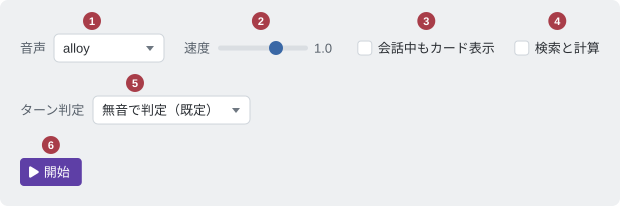

# チャット・アシスタントアプリ

汎用的な会話・アシスタント系のアプリです。チャット、音声での会話のほか、百科事典の検索・数学・セカンドオピニオン・リサーチ・Monadic Chat 自体のヘルプのアシスタントがあります。

## Chat

AI と会話をするアプリです。AI は適切な絵文字を付けて応答します。tool calling に対応したモデルでは Web 検索を使えます。プロバイダー自身の検索と Tavily API（`TAVILY_API_KEY` が必要）のどちらを使うかは、[プロバイダー機能概要の表](../basic-usage/basic-apps.md#provider-capabilities)を参照してください。

Chat は、会話の内容を記録しながら進めます。返答のたびに、そのやりとりから次の一覧が更新され、[作業画面](../basic-usage/web-interface.md#work-screen)に **Context** のページとして表示されます。返答は一覧の更新を待たずに表示され、更新の間は作業画面のタブに印が付きます。

- **Topics**：ここまでの会話で取り上げたトピック
- **People**：会話に出てきた人物
- **Notes**：覚えておくべき事実や好み

一覧は、返答ごとに同じプロバイダーとモデルへの問い合わせを 1 回増やして作ります。項目を忘れる、消す、一覧を空にすることを頼むと、その返答の中で保存した一覧から消えます。会話そのものには、話した内容が残ります。ターンを削除すると、そのターンが一覧に足したものは元に戻ります。`tools` の能力を持たない Ollama のモデルでは記録されません。

メッセージ入力欄の下の `URLを開く` で、Web ページを作業画面に開くか、そのテキストをメッセージに読み込めます。どのプロバイダーでも使えます。

本アプリの対応プロバイダーは[モデル対応状況の表](../basic-usage/basic-apps.md#app-availability)を参照してください。

## Voice Chat :id=voice-chat

声で AI と会話するアプリです。話した内容は音声パネルで選んだ **音声認識モデル** で文字に起こされ、応答は同じパネルで選んだ **テキスト読み上げプロバイダー** で読み上げられます。読み上げの既定はブラウザ内蔵の Web Speech API で、API キーは要りません。代わりに OpenAI、ElevenLabs、Gemini、Mistral、xAI Grok の声も選べます。会話のプロバイダーと音声のプロバイダーは自由に組み合わせられます（例：会話は Claude、声は xAI Grok）。

話している間は波形が表示されます。文字起こしのモデルが確からしさの値を返すときは、話し終えた後に p-value が表示されます。[音声入力](../basic-usage/message-input.md#speech-input)を参照してください。

Voice Chat の対応プロバイダーは[モデル対応状況の表](../basic-usage/basic-apps.md#app-availability)を参照してください。音声の設定は [音声パネル](../basic-usage/web-interface.md#speech-settings-panel)を参照してください。

**エクスプレッシブスピーチ**：自動音声がオンで、対応する読み上げのプロバイダーを選んでいると、**テキスト読み上げプロバイダー** のメニューの下に ✨ **エクスプレッシブスピーチ** のバッジが表示されます。応答は、間・笑い・声の指示などの表現を付けて読み上げられ、これらはテキストには現れません。やり方はプロバイダーによって違います。[音声パネル](../basic-usage/web-interface.md#speech-settings-panel)を参照してください。

プロバイダーのリアルタイム speech-to-speech API に音声を直接送る、途切れないハンズフリーの会話については、下の [Live Conversation](#live-conversation) を参照してください。

## Live Conversation :id=live-conversation

途切れないハンズフリーの音声会話ができるアプリです。音声認識・言語モデル・音声合成を 3 つの段階で処理する [Voice Chat](#voice-chat) と違い、プロバイダーのリアルタイム speech-to-speech API に音声を直接送るので、応答が早く、ボタンを押さずに会話が進みます。

OpenAI、xAI Grok、Google Gemini の 3 つの版があります。それぞれ、そのプロバイダーの API キーが設定されているときだけ選べます。

1. **音声**：アシスタントの声。
2. **速度**：再生の速さ（OpenAI のみ）。
3. **会話中もカード表示**：会話の途中も、会話をカードで表示します。
4. **検索と計算**：アシスタントが会話中にツールを使えるようにします。
5. **ターン判定**：発話の終わりの決め方（OpenAI のみ）。
6. **開始**：会話を始めます。同じボタンで終了します。

**使い方**：`Start` をクリックすると会話が始まります。あとは自然に話してください。話し終わりは自動で検出され（音声区間検出）、ターンが進みます。`End` をクリックするとセッションが終わります。このアプリにはテキストの入力欄はありません。ヘッドホンをお勧めします。スピーカーだと、アシスタントの声がマイクに入り、意図しないターンが始まることがあります。

**声と速度**：アシスタントの声は、アプリの操作欄にあるメニューで選びます（音声パネルの読み上げの設定は使われません）。選べる声の数は、OpenAI が 10（既定：alloy）、xAI が 26（既定：eve）、Gemini が 30（既定：Kore）です。再生速度のスライダー（0.25〜1.5）は OpenAI だけで使えます。声の選択はプロバイダーごとに記憶されます。

**ターン判定**（OpenAI 版のみ）：話し終わりの判定の方法を選べます。既定は無音で判定します。「意味で判定」の 3 つのモード（ゆっくり・標準・すばやく）では、話の内容がまとまったと聞こえるまでモデルが待ちます。違いがどれくらい出るかは、言語や話し方によって変わるので、両方を試してください。選択は記憶され、次のセッションから使われます。

**表示**：会話中の既定のライブ表示では、相手の直前の発話と進行中の発話が 2 つの領域に表示されます。**会話中もカード表示** にチェックを入れると、会話中もカードで表示されます。この設定はセッション中だけ効きます。セッションが終わると必ずカードの一覧に戻り、ほかの会話と同じように編集・保存・読み込みができます。

ライブ表示では、アシスタントが今読み上げている文が強調表示され、声を文字で追えます。テキストは音声よりかなり早くそろうので、長い応答で役に立ちます。強調表示は音声そのものに合わせて進み、ツールの実行中は止まり、割り込んだときは読み上げが止まった位置で止まります。カード表示では出ません。

**検索と計算**（既定はオフ）：**検索と計算** のスイッチをオンにすると、アシスタントが会話中にツールを使えます。使えるのは、現在時刻、Python のコードの実行、Knowledge Base の検索、Web 検索（`TAVILY_API_KEY` が必要）です。Python と Knowledge Base は、それぞれのコンテナが動いているときだけ使えます。ツールを使ったターンは 1 枚のカードにまとまり、ツールを呼んだ段落の境目に、ツール名の入った 🛠 のバッジが付きます（失敗したときは赤）。呼び出し中は、状態の行に「{ツール名} を使用中…」と表示されます。

**作業画面**：アシスタントは、会話の途中で[作業画面](../basic-usage/web-interface.md#work-screen)を見られます。作業画面で見ているもの（「これ」「このリスト」「印を付けた所」など）について話すと、このタブで表示している項目を見ます。見るのは、テキストファイルの見えている行、PDF のそのページの文字と、その中で選んだ文字です。ページに印を付けていれば、印の中の文字も受け取ります。OpenAI 版と Google Gemini 版は、ページの見えている部分も印ごと見ます。xAI Grok 版には、代わりに印の位置が伝わります。アシスタントは作業画面に書くこともできます。一緒に作るリストやメモ、計画を残すよう頼むと、作業画面に文書として表示し、項目を足したり直したりするたびに書き直します。表やメモのページをファイルとして置くこともできます。ターンを削除すると、そのターンで書いたものは取り消されます。作業画面を見たり書いたりするのにスイッチは要らず、**検索と計算** の道具には含まれません。

**セッションの動作**：無音が続くと自動で止まります（既定：3 分）。Gemini のセッションには 15 分の接続の上限があり、上限に達すると自動でつなぎ直して会話が続きます。音声がプロバイダーに直接届くので、[語を伏せている](../advanced-topics/anonymization.md)会話では使えません。会話は、ほかの会話と同じように Knowledge Base に保存できます。リアルタイムのモデルは推論の過程を出力しないので、思考過程の表示はありません。

**料金**：接続している間は、無音の時間にも料金がかかり、単価はプロバイダーによってかなり違います。長いセッションの前に、各プロバイダーの料金のページを確かめてください。実際の使用量にもとづく料金の目安が、画面の上部に表示されます。

## Wikipedia

最近の出来事など、AI の知識にない話題について質問できるアプリです。Chat と同じように使え、必要なときに Wikipedia を検索します。既定では英語版の Wikipedia を検索し、頼めばほかの言語版も検索します。Wikipedia は OpenAI で使えます。

## Math Tutor

数学の質問と回答のためのアプリです。数式は [KaTeX](https://katex.org/) で表示されます。

Math Tutor は Python のコードを実行して計算でき、セッションで解いた問題・扱った概念・練習が必要な分野・メモを記録し、作業画面に **Learning notes** のページとして表示します。コードが描いたグラフや図は、会話のフォルダに保存され、会話の横の[作業画面](../basic-usage/web-interface.md#work-screen)に表示されます。数式の説明は会話の中に表示されます。

!> **注意：** LLM は、手順の多い計算や複雑な論理で間違えることがあります。結果を確かめ、正確さが大事なときは Python で計算するように頼んでください。

## Second Opinion

回答について、別の意見をもらうアプリです。まず質問をして回答を受け取ります。次に「この回答を確認して」のように頼むと、どのプロバイダーに確認してもらうかをアプリが尋ね（指定しなければ OpenAI）、その確認の結果を表示します。複数のプロバイダー（2〜5）にまとめて頼むこともできます。

Second Opinion の対応状況は[モデル対応状況の表](../basic-usage/basic-apps.md#app-availability)を参照してください。

## Research Assistant

学術・科学の調査のためのアシスタントです。Web を検索し、情報源を読んで分析し、セッションで調べたトピック・わかったこと・情報源・検索を記録し、作業画面に **Research notes** のページとして表示します。最新の情報を探す、事実を確かめる、トピックをまとめる、といった用途に使えます。Python のコードが作ったグラフなどのファイルは、会話のフォルダに保存され、会話の横の[作業画面](../basic-usage/web-interface.md#work-screen)に表示されます。返答では、そのパスが示されます。

Research Assistant の対応プロバイダーは[モデル対応状況の表](../basic-usage/basic-apps.md#app-availability)を参照してください。Web 検索でプロバイダー自身の検索と Tavily API（`TAVILY_API_KEY` が必要）のどちらを使うかは、[プロバイダー機能概要の表](../basic-usage/basic-apps.md#provider-capabilities)のとおりです。Web ページをメッセージに読み込む方法は、[URL からのテキストの読み込み](../basic-usage/message-input.md#reading-text-from-urls)を参照してください。

## Monadic Chat Help

Monadic Chat について、機能・使い方・問題の解決のしかたを、どの言語でも質問できます。アシスタントは Monadic Chat のドキュメントを検索し、それにもとづいて答えます。

ドキュメントの検索には、Monadic Chat情報パネルの **ヘルプデータ** からインストールするヘルプデータを使います。Monadic Chat Help は OpenAI を使うので、OpenAI の API キーが必要です。[ヘルプシステム](../advanced-topics/help-system.md)を参照してください。
