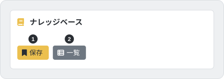

# Knowledge Base

チャットのセッションを保存し、文書を取り込んで、まとめて検索できるライブラリです。

Knowledge Base には、会話と文書（会話の記録、PDF、Office のファイル、Markdown、ソースコード）を入れられます。サイドバーの **書庫** のタブはそのすべてを表示し、Knowledge Base を検索するアプリは、どれもそのすべてを検索します。

1. **保存**：今の会話を Knowledge Base に保存します。
2. **一覧**：サイドバーの **書庫** のタブを開きます。
3. **このセッションでナレッジベース検索を使う**：モデルが回答の途中で Knowledge Base を検索できるようにします。

**内容を加える方法：**

1. **今のチャットのセッションを保存する**：サイドバーのナレッジベースパネルの **保存** ボタンで、今の会話を Knowledge Base に保存します。
2. **作業画面の文書を収める**：[作業画面](../basic-usage/web-interface.md#work-screen)の文書（下の形式のもの）の下の **書庫に収める** で、表示している版を取り込みます。
3. **この会話を文書として収める**：**書庫** のタブの **この会話を書庫に収める** で、会話を Markdown の文書として作業画面に置きます（題名・アプリ・モデル・日付、そのあと発言ごとに見出し）。会話のファイルは名前だけが残り、中身は入りません。システムプロンプト、思考の過程、道具の記録は入りません。作業画面で確かめてから **書庫に収める** で収めます。
4. **ファイルを取り込む**：サイドバーの **書庫** のタブを開き、**ファイルを読み込み** をクリックして、下の形式のファイルをアップロードします。ファイルからテキストが取り出され、節に分けられ、検索・表示・名前の変更ができる 1 つの項目として保存されます。ファイルそのものは、共有フォルダの外の `~/monadic/library` に保存されます。項目を削除するとファイルも削除されます（同じファイルから作った項目がほかにあるときは残ります）。

**取り込める形式：**

| 形式 | 拡張子 |
|---|---|
| Markdown | `.md`、`.markdown`、`.mdx` |
| ソースコード | `.rb`、`.py`、`.js` / `.ts`、`.go`、`.java`、`.kt`、`.swift`、`.rs`、`.c` / `.cpp`、`.cs`、`.php`、`.sh`、`.sql` など |
| PDF | `.pdf` |
| Office | `.docx`、`.xlsx`、`.pptx` |

PDF からはテキストと表が取り出されます。Knowledge Base 品質パックを入れているときは、レイアウトの解析と OCR が使われます。入れていないときは、画像だけの PDF からはテキストが取り出されません。

[語を伏せている](../advanced-topics/anonymization.md)会話は保存できませんが、検索はできます。

**そのほかの機能：**

- **もう一度保存すると項目が更新される**：同じチャットのセッションをもう一度保存すると、新しい項目は作られず、前の項目が更新されます。このときダイアログは「ナレッジベースの会話を更新」となり、**更新** ボタンと注意書きが表示されます。セッションと項目の結び付きは、リセット、アプリの切り替え、一覧での項目の削除で切れます。
- **タイトルの提案**：会話を初めて保存するとき、今のプロバイダーのモデルが会話にもとづいてタイトルの欄を埋めます。自由に書き換えられます。提案は保持されるので、ダイアログを閉じて開き直しても、モデルにもう一度尋ねることはありません。
- **名前の変更**：会話ビューアを開き、タイトルの横の鉛筆のアイコンをクリックして編集し、保存します。
- **最近の保存と件数**：サイドバーに最近の保存と全体の件数が表示されます。**書庫** のタブでは、検索と並べ替えができます。
- **作業画面で開く**：書庫のタブの行の最初のボタンで、項目の本文を[作業画面](../basic-usage/web-interface.md#work-screen)に置きます。AI もほかの項目と同じように読めます。書庫で項目が変わったり削除されたりすると、作業画面にそう表示されます。
- **会話ビューア**：行をクリックすると、その項目のすべてのメッセージが表示されます。システムプロンプトは折りたたまれています。
- **アプリでの検索**：ナレッジベースパネルの **このセッションでナレッジベース検索を使う** をオンにすると、モデルが回答の途中で Knowledge Base を検索できます。モデルが読んだ文章は[作業画面](../basic-usage/web-interface.md#work-screen)に置かれ、返答の下に、引用した数とともに表示されます。返答の中で引用された文章は、そのリンクから開けます。このスイッチは既定でオフで、アプリごとに記憶されます。あるアプリでオンにしても、ほかのアプリではオフのままです。Live Conversation では、代わりにアプリの **検索と計算** のスイッチを使います。
- **Knowledge Base のバッジ**：セッションが Knowledge Base を読める間、会話の見出しに緑の「Knowledge Base」バッジが表示されます。検索のスイッチがオンのときに表示されます。

?> Knowledge Base は、テキストをお使いのコンピューターの上でベクトルに変換し、Qdrant に保存します。取り込みと検索に API キーは要りません。[ベクトルデータベース](../docker-integration/vector-database.md)を参照してください。
