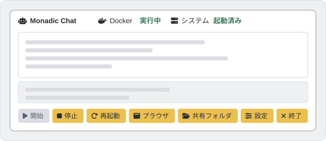
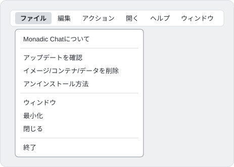
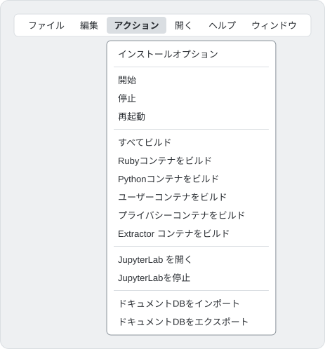
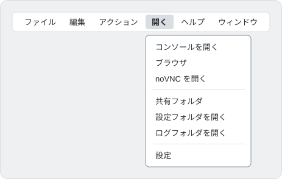
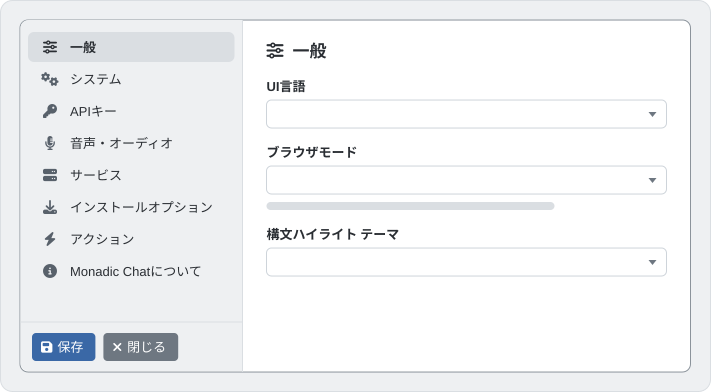
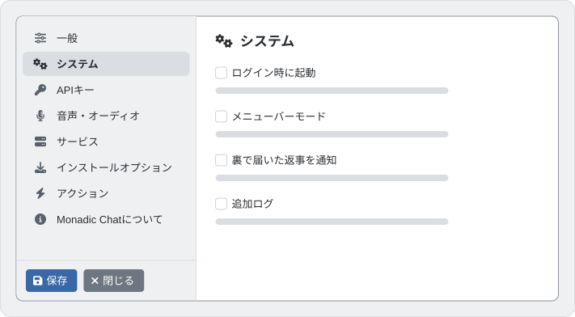
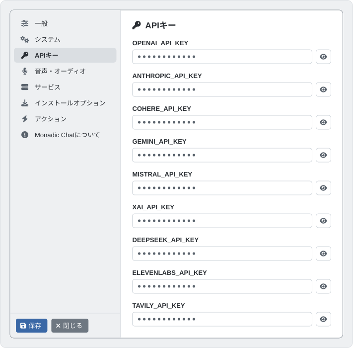
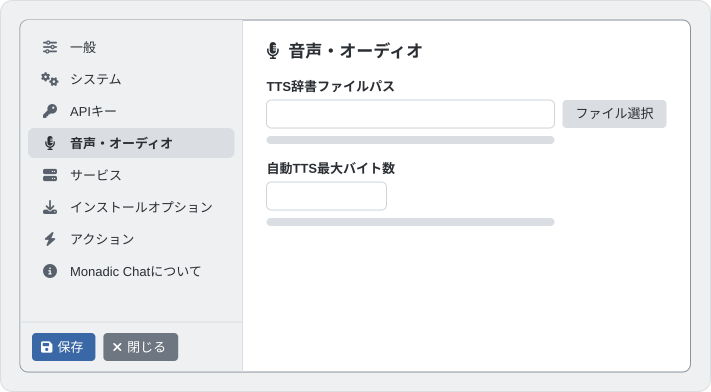
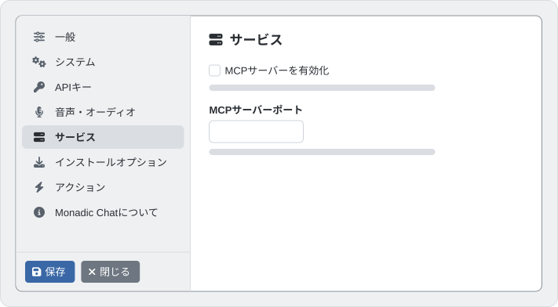

# Monadic Chat コンソールパネル

## コンソールボタン項目

コンソールパネルはMonadic Chatのメイン制御インターフェースです。現在のステータス（停止中、起動中、起動済みなど）を表示し、一般的な操作へのクイックアクセスボタンを提供します。

**開始**  
Monadic Chatを起動します。初回起動時はDocker上での環境構築のため少し時間がかかります。

**停止**  
Monadic Chatを停止します。

**再起動**  
Monadic Chatを再起動します。

**ブラウザ**  
Monadic ChatをWebブラウザで開きます。
アクセス URL: [http://localhost:4567](http://localhost:4567)

**共有フォルダ**  
ホストコンピュータとDockerコンテナ間で共有されるフォルダーを開きます。共有フォルダはファイルのインポートやエクスポート、追加アプリの導入に使用します。フォルダ構成と各サブフォルダ（`apps`、`helpers`、`scripts`）の役割については[共有フォルダ](../docker-integration/shared-folder.md)を参照してください。

**設定**  
下記の[設定パネル](#settings-panel)を開きます。

**終了**  
Monadic Chatを終了します。

## コンソールメニュー項目

コンソールには、File、Edit、Actions、Open、Help、Window のメニューがあります。macOS では、File メニューは Monadic Chat という名前で表示されます。Edit には通常の編集のコマンド、Help には文書を開くコマンド、Window には Minimize、Close、Reload があります。

### Actions メニュー

ビルドのコマンドは Monadic Chat が止まっているとき、JupyterLab のコマンドは動いているとき、ドキュメント DB のコマンドは止まっているときに使えます。

**インストールオプション**  
設定ウィンドウの Install Options パネルを開きます。サービスコンテナにインストールするオプションパッケージ（LaTeX、Pythonライブラリ、伏せる名前を探す追加言語など）を選択できます。

**Start**  
Monadic Chatを起動します。初回起動時はDocker上での環境構築のため少し時間がかかります。

**Stop**  
Monadic Chatを停止します。

**Restart**  
Monadic Chatを再起動します。

**すべてビルド**  
Ruby と Python のイメージをビルドのキャッシュなしでビルドし、ほかのビルド済みのイメージをダウンロードし、ユーザーが定義したコンテナもビルドします。

**Rubyコンテナをビルド**  
Monadic Chat を動かすイメージとコンテナ（`monadic-chat-ruby-container`）を、ビルドのキャッシュなしでビルドします。

**Pythonコンテナをビルド**  
AI エージェントが使うイメージとコンテナ（`monadic-chat-python-container`）を、ビルドのキャッシュなしでビルドします。

**ユーザーコンテナをビルド**  
ユーザーが定義したコンテナ（[Dockerコンテナの追加](../advanced-topics/adding-containers.md)を参照）を、ビルドのキャッシュなしでビルドします。通常の Start ではビルドされないので、定義を追加・変更した後はこのコマンドを使います。

**プライバシーコンテナをビルド**  
[匿名化](../advanced-topics/anonymization.md)のために名前を探すコンテナ（`monadic-chat-privacy-container`）のイメージをダウンロードします。`PRIVACY_FILTER=false` を設定していないときに使えます。

**Extractor コンテナをビルド**  
Knowledge Base Quality Pack が使うコンテナ（`monadic-chat-extractor-container`）のイメージをダウンロードします。Quality Pack をインストールしているときに使えます。

**JupyterLab を開く**  
JupyterLab（[http://localhost:8889](http://localhost:8889)）をブラウザーで開きます。動いていなければ、先に起動します。詳細は[JupyterLabとの連携](../docker-integration/jupyterlab.md)を参照してください。

**JupyterLabを停止**  
JupyterLabを停止します。

**ドキュメントDBをインポート**  
ドキュメント DB（ナレッジベースに保存した会話・PDF・その他の Knowledge Base エントリすべて）を、共有フォルダ内の書き出したファイルから取り込みます。会話の履歴はドキュメント DB に含まれず、変わりません。実行前に、現在の DB を置き換えることを警告する確認ダイアログ（**Replace and Import**）が表示されます。受け入れられるファイル名は `monadic-qdrant.tar.gz`（平文）または `monadic-qdrant.tar.gz.enc`（暗号化、エクスポート時のパスフレーズを入力するよう促されます）です。

**ドキュメントDBをエクスポート**  
ドキュメント DB 全体を共有フォルダにエクスポートします。確認ダイアログには 2 つの選択肢があります: **Encrypt and Export**（デフォルト — パスフレーズを尋ね、`monadic-qdrant.tar.gz.enc` を書き出します）と **Export Plain**（暗号化せずに `monadic-qdrant.tar.gz` を書き出します。ナレッジベースに保存した会話と PDF が平文で含まれることを強く警告）。エクスポートには[会話の履歴](web-interface.md#chat-history-panel)は含まれません。マシン外に出る可能性があるエクスポートは暗号化版を使ってください。暗号化フォーマットとインポート／復号の挙動の詳細は [匿名化](../advanced-topics/anonymization.md#document-db-export-import) を参照してください。

### Open メニュー

**コンソールを開く**  
Monadic Chatのコンソールを開きます。

**ブラウザ**  
Monadic Chatをデフォルトブラウザで開きます。アクセスURL: [http://localhost:4567](http://localhost:4567)

**noVNC を開く**  
noVNCビューアウィンドウ（`http://localhost:7900`）を開き、Seleniumコンテナ内で動作しているブラウザの画面を表示します。Web自動操作の様子をリアルタイムで確認（および操作）できます。Monadic Chatの実行中に利用できます。

**共有フォルダ**  
ホストコンピュータとDockerコンテナ間で共有されるフォルダーを開きます。共有フォルダはファイルのインポートやエクスポート、追加アプリの導入に使用します。フォルダ構成と各サブフォルダ（`apps`、`helpers`、`scripts`）の役割については[共有フォルダ](../docker-integration/shared-folder.md)を参照してください。

**設定フォルダを開く**  
Monadic Chatの設定ファイルが保存されているフォルダを開きます。このフォルダ内には下記のファイルが含まれます。

- `env`: 設定のファイル（設定ウィンドウで設定）
- `pysetup.sh`: Python環境をセットアップするスクリプト（オプション、ユーザー作成）
- `rbsetup.sh`: Ruby環境をセットアップするスクリプト（オプション、ユーザー作成）
- `models.json`: モデルの設定の上書き（オプション、ユーザー作成）。[設定](../reference/configuration.md)を参照
- `TTS_DICT.csv`: 音声合成の辞書。設定ウィンドウで辞書を指定すると、ここに写されます
- `compose.yml`: Docker Compose設定ファイル（ユーザーコンテナがあるときに生成）

**ログフォルダを開く**  
Monadic Chatのログファイルが保存されているフォルダを開きます。このフォルダ内には下記のファイルが含まれます。

- `docker_build.log`: Dockerビルドのログファイル（Python コンテナは `docker_build_python.log`）
- `docker_startup.log`: Docker起動のログファイル
- `server.log`: Monadic Chatのサーバーログファイル
- `command.log`: Monadic Chatのコマンド実行およびコード実行ログファイル
- `jupyter.log`: Jupyterノートブックに追加されたセルのログファイル

設定パネルで`Extra Logging`を有効にすると、`extra.log`が追加され、Monadic Chatの起動から終了までのチャットがストリーミングされるJSONオブジェクト単位で記録されます。デバッグ用です。

**Settings**  
Monadic Chatの設定ウィンドウを開きます。Webインターフェースのシステム設定画面とは別のものです。

### File メニュー

**Monadic Chatについて**  
アプリケーションのバージョン情報を表示します。

**アップデートを確認**  
アプリケーションの更新を確認します。新しい版があると、**Download & Install** のあるダイアログが表示されます。ダウンロードが終わったら、**Restart Now** でインストールするか、**Later** を選びます。

**イメージ/コンテナ/データを削除**  
Monadic Chat の Docker イメージ、コンテナ、ボリューム（Knowledge Base のデータ）を削除します。`~/monadic` のファイルは残ります。

**アンインストール方法**  
お使いのOSに応じた完全なアンインストール手順を記載したオンラインドキュメントを開きます。

**Quit**  
アプリケーションを終了します。

## 設定パネル :id=settings-panel

変更は、サイドバーの下の **保存** で保存します（保存していない変更があるまま閉じると、保存するかを尋ねます）。設定ウィンドウはサイドバーからアクセスできる次のセクションに分かれています: **一般**、**システム**、**APIキー**、**音声・オーディオ**、**サービス**、**インストールオプション**、**アクション**、**Monadic Chatについて**。

### 一般

**UI Language**  
コンソールと設定ウィンドウの表示言語を選択します。

**Browser Mode**  
コンソールからMonadic Chatを開く際に使用するブラウザを選択します。"Internal Browser"は組み込みのElectronブラウザウィンドウを開き、"External Browser"はシステムのデフォルトWebブラウザを開きます。

**Syntax Highlighting Theme**  
コードブロックでのシンタックスハイライトのテーマを選択します。デフォルトは`github-light`です。

### システム

**Launch at Login**  
コンピュータへのログイン時にMonadic Chatを自動的に起動します。

**Menu Bar Mode**  
コンソールウィンドウを表示する代わりに、メニューバーに常駐させます（macOS）。

**Notify When a Reply Arrives in the Background**  
内部ブラウザのウィンドウを閉じると、ウィンドウは隠れ、会話はそのまま残ります。**ブラウザ** か、メニューバー（システムトレイ）のメニューの **Web UI を表示** で、ウィンドウが戻ります。閉じたときに作っていた返事は受け取り続け、届くと通知が出ます。通知を押しても、ウィンドウが戻ります。通知に会話の文は入りません。ウィンドウを隠すときに、音声入力と Live の会話を止め、音声の再生も止めます。隠れている間は音声を鳴らさず、マイクも使えません。会話を終えるときは、**Reset** を使うか、メニューバーのメニューで **Web UI を閉じる** を選ぶか、Monadic Chat を終了します。この設定をオフにすると、通知を出さずに隠します。

**Extra Logging**  
詳しいログ情報を有効にするかどうかを選択します。有効にすると、APIリクエストとレスポンスの詳細がログに記録されます。ログファイルは `~/monadic/log/extra.log` に保存されます。

### APIキー

使用したいプロバイダーのキーを入力します。アカウントを持っているものだけ設定すれば十分です。OpenAIのキーは対応範囲が広く、チャットモデルに加えて画像生成・Speech-to-Text・Text-to-Speechにも同じキーが使われるため、最初に用意する価値が最も高いキーです。

各キーで何が使えるようになるか、どのアプリで必須かは[設定](../reference/configuration.md#api-keys)を参照してください。

| 設定項目 | キーの取得先 |
| --- | --- |
| `OPENAI_API_KEY` | [platform.openai.com](https://platform.openai.com/docs/guides/authentication) |
| `ANTHROPIC_API_KEY` | [console.anthropic.com](https://console.anthropic.com) |
| `COHERE_API_KEY` | [dashboard.cohere.com](https://dashboard.cohere.com) |
| `GEMINI_API_KEY` | [ai.google.dev](https://ai.google.dev/) |
| `MISTRAL_API_KEY` | [console.mistral.ai](https://console.mistral.ai/) |
| `XAI_API_KEY` | [x.ai/api](https://x.ai/api) |
| `DEEPSEEK_API_KEY` | [platform.deepseek.com](https://platform.deepseek.com/) |
| `ELEVENLABS_API_KEY` | [elevenlabs.io/developers](https://elevenlabs.io/developers) |
| `TAVILY_API_KEY` | [tavily.com](https://tavily.com/) |

`TAVILY_API_KEY`だけは特定のプロバイダーに紐づきません。**URLを開く**のテキストの取り込み（Seleniumの代替）と、ネイティブ検索機能を持たないプロバイダーでのWeb検索に使われます — 対象プロバイダーは[プロバイダー機能概要の表](../basic-usage/basic-apps.md#provider-capabilities)を参照してください。

### 音声・オーディオ

**TTS Dictionary File Path**  
Text-to-Speech辞書ファイルのパスを入力します。辞書ファイルはCSV形式で、置き換えられる文字列と音声合成に使用される文字列のカンマ区切りのエントリが含まれています（ヘッダ行は不要）。Text-to-Speechを使用する際、テキスト内の置き換えられる文字列は音声合成用の文字列に置き換えられます。

**Auto TTS Max Bytes**  
自動音声読み上げ（post-completionモード）で読み上げるテキストの最大サイズ（バイト単位）を設定します（既定：500）。この上限を超えるテキストは一部のみ再生されるか、スキップされます。

?> Speech-to-Textモデルの選択は、この設定ウィンドウではなくWeb UIの Speech パネルで行います。[Speech パネル](./web-interface.md#speech-settings-panel)を参照してください。

### サービス

**Enable MCP Server**  
Model Context Protocol（MCP）サーバーを有効にします。Monadic Chatのツールを外部のAIアシスタントから利用できるようになります。詳細は[MCP連携](../advanced-topics/mcp-integration.md)を参照してください。

**MCP Server Port**  
MCPサーバーが使用するネットワークポートです（デフォルト: `3100`）。他のサービスとポートが競合する場合のみ変更してください。

### インストールオプション

Python コンテナにインストールするオプションパッケージを選択します: LaTeX、Pythonライブラリ（NLTK、spaCy、gensim、MediaPipe、Transformers）、音楽分析（librosa、madmom）、システムツール（ImageMagick）。保存しても再ビルドは行われません。次回の起動時に**Rebuild and Start**が提示されるか、**アクション → Pythonコンテナをビルド** から手動で実行します。

同じパネルには、さらに 2 つのグループがあります。

- **Name Finder — Additional Languages**：英語のほかに伏せる名前を探す言語（ドイツ語、スペイン語、フランス語、イタリア語、日本語、オランダ語、ポルトガル語、中国語）。保存すると、再ビルドなしで反映されます。
- **Knowledge Base Quality Pack (Docling)**：文書の取り込みの質を上げる extractor のコンテナと、その OCR の言語（英語、日本語、中国語、韓国語）をインストールします。[Knowledge Base](../apps/knowledge-base.md) を参照してください。

### アクション

Docker の状態を表示し、Actions メニューの操作を提供します：Start、Stop、Restart、コンテナのビルド（ビルドの前にコンテナを止める必要があります）、JupyterLab の起動と停止、ドキュメント DB の Import と Export。操作を実行すると、保存していない設定を先に保存します。

### Monadic Chatについて

アプリケーションのバージョン、**アップデートを確認**、ホームページとソースコードへのリンクを表示します。
