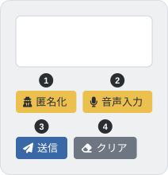
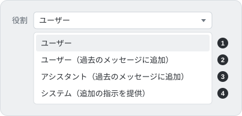
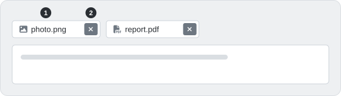
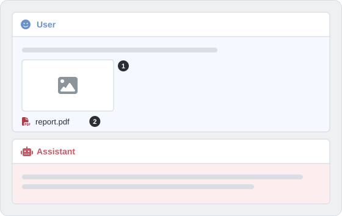
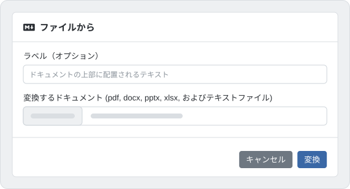
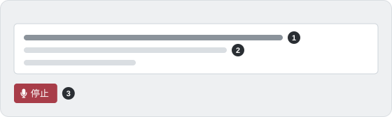

# メッセージ入力

サーバーを起動し、アプリを選んで設定した後に **セッションを開始** ボタンをクリックすると、次の画面が表示されます。

1. **画像**（モデルによっては **ファイル添付**）：画像や PDF をメッセージに添付します。[画像のアップロード](#uploading-images)を参照してください。
2. **ファイルからテキスト**：文書のテキストをメッセージに読み込みます。[文書ファイルからのテキスト読み込み](#reading-text-from-document-files)を参照してください。
3. **URLを開く**：Web ページを作業画面に開くか、そのテキストをメッセージに読み込みます。[URL を開く](#reading-text-from-urls)を参照してください。
4. **匿名化**：メッセージの中の名前を見つけ、伏せるものを選びます。[匿名化](#anonymize)を参照してください。
5. **音声入力**：声を録音し、話した内容をメッセージに書き込みます。[音声入力](#speech-input)を参照してください。
6. **送信**：メッセージを送ります。
7. **クリア**：入力欄を空にします。

テキストエリアにメッセージを入力し、**送信** ボタンをクリックすると、メッセージが送信されます。音声入力については下記の[音声入力](#speech-input)を参照してください。

?> 音声入力と音声合成を使って AI エージェントとのチャットをスムーズに行うには、サイドバーのインタラクションパネルで **自動音声** と **簡単送信** をオンにすると便利です。[Voice Chat](../apps/chat-apps.md#voice-chat)アプリではこれらが既定でオンです。

?> **役割** セレクタはメッセージの役割を選びます。通常は **ユーザー** を選びます。**ユーザー（過去のメッセージに追加）** と **アシスタント（過去のメッセージに追加）** は、送らずに会話にメッセージを加えます。**システム（追加の指示を提供）** は指示を加えます。詳しくは [FAQ](../faq/faq-user-interface.md) を参照してください。

1. **ユーザー**：AI に送る、ふつうのメッセージ。
2. **ユーザー（過去のメッセージに追加）**：送らずに、あなたのメッセージとして会話に足します。
3. **アシスタント（過去のメッセージに追加）**：送らずに、AI の返答として会話に足します。
4. **システム（追加の指示を提供）**：指示として会話に足します。

## 画像のアップロード :id=uploading-images

画像アップロードは、ビジョン機能を持つモデル（OpenAI、Anthropic Claude、xAI Grok、Google Gemini、Mistral、Cohere、DeepSeek、Ollama のビジョンモデル）で利用できます。

**画像**（PDFもサポートするモデルでは**画像/PDF**）をクリックして画像を選択します。対応形式：JPG、JPEG、PNG、GIF、WebP。1 つのメッセージに 5 枚まで添付できます。

1. 添付したファイル。名前をクリックすると、送る前に中身を確かめられます。
2. ファイルをメッセージから外します。

画像をアップロードすると、メッセージ入力エリアの下に、削除ボタン（×）付きのサムネイルが表示されます。画像はテキストのプロンプトと一緒に送られ、メッセージを送ると添付は外れます。

添付画像は送信前にブラウザ側で縮小されます（長辺最大 2000px、短辺最大 768px）。細部を原寸で解析したい場合は、画像ファイルを共有フォルダに置いて AI に解析を依頼してください — 画像解析スキルを持つアプリは元ファイルを直接読み込み、original 精度での解析を指示できます。

1. 画像。送ったメッセージのカードの中に表示されます。
2. PDF。名前で表示されます。

## PDF のアップロード :id=uploading-pdfs

一部のプロバイダー（OpenAI、Anthropic Claude、Google Gemini）はPDFアップロードに対応しています。**画像/PDF**ボタンをクリックしてPDFファイルを添付します。

?> **Anthropic Claude**: Claudeのモデルを用いたアプリでは、PDFを直接アップロードしてAIエージェントに内容を認識させることが可能です。

PDF は添付したメッセージと一緒に送られ、その後のターンでも会話の履歴の中に残ります。

## 拡張ドキュメント形式のアップロード :id=uploading-extended-documents

一部のOpenAIモデルは、File Inputs APIを通じて拡張されたドキュメント形式をサポートしています。そうしたモデルでは、ボタンが**ファイル添付**になり、画像やPDFに加えて以下の形式を受け付けます（50 MB まで、PDF は 35 MB まで）：

- スプレッドシート: `.xlsx`, `.csv`
- ドキュメント: `.docx`, `.pptx`, `.txt`, `.md`
- データ/マークアップ: `.json`, `.html`, `.xml`

ファイルはセッションごとにキャッシュされるため、同じドキュメントは複数ターンにわたって参照されても OpenAI へのアップロードは1回のみです。

Responses APIを使用するモデルでは、ローカルファイルのアップロードの代わりに、モーダルダイアログでファイルのURLを直接入力することもできます。

## 動画と音声のファイルの添付 :id=attaching-video-audio

動画を分析するアプリや音声を文字起こしするアプリでは、**画像** ボタンで動画（MP4、M4V、MOV、WebM、MKV、AVI）や音声（MP3、M4A、WAV、OGG、Opus、FLAC、AAC、WebM）のファイルも添付できます。ファイルはチャットのフォルダにアップロードされ、メッセージを送るまでメッセージ欄の下に表示されます。本文を書かずに、添付したファイルだけを送ることもできます。添付したファイルはメッセージのカードに表示されます。Video Describer は動画を、Speech Draft Helper は音声のファイルを受け付けます。

## 文書ファイルからのテキスト読み込み :id=reading-text-from-document-files

**ファイルからテキスト** ボタンをクリックすると、文書ファイルを選択するダイアログが表示されます。選択したファイルの内容がテキストエリアに読み込まれます。読み込みが可能なファイル形式はPDF、Wordファイル（`.docx`）、Excelファイル（`.xlsx`）、PowerPointファイル（`.pptx`）、さまざまなテキストファイル（`.txt`, `.md`, `.html`, etc）です。

## URL を開く :id=reading-text-from-urls

メッセージ欄の下の **URLを開く** をクリックし、`http://` か `https://` で始まるアドレスを入れます。

- **作業画面で開く**：会話のブラウザーで、そのページを[作業画面](web-interface.md#work-screen)に開きます。ブラウザーの道具を持つアプリや、作業画面を見られるアプリでは、アシスタントがそこからページを読みます。
- **テキストとして取り込む**：ページの文を Markdown 形式でメッセージ欄に読み込みます。

1. ページのアドレス。
2. **テキストとして取り込む**：ページのテキストをメッセージに読み込みます。
3. **作業画面で開く**：ページを作業画面に開きます。

## 匿名化 :id=anonymize

メッセージ欄の横の **匿名化** をクリックすると、会話が送る文の中でプレースホルダーに置き換える語（名前など）を選べます。対象は文だけです。画像、ファイルの中身、コードの実行やブラウザーが読むファイルとページ、声、選んでいない名前、すでに送ったものは対象外です。[匿名化](../advanced-topics/anonymization.md)を参照してください。

## 音声入力 :id=speech-input

?> 音声入力はChrome、Edge、Safariでサポートされています。

音声入力を行う場合は、**音声入力** ボタンをクリックして音声入力を開始し、**停止** ボタンをクリックして音声入力を終了します。音声入力が終了すると、Speech-to-Text API を通じて音声がテキストに変換され、テキストエリアに表示されます。iPhone と iPad では音声入力は使えません。

[Live Conversation](../apps/chat-apps.md#live-conversation) はこの経路を使いません。テキスト入力も **音声入力** ボタンもなく、セッション中はマイクが常時ストリーミングされます。

1. 話した内容が、入力欄に書き込まれます。
2. 直前の書き起こしの信頼度。音声認識のモデルが値を返すときに表示されます。
3. 録音中は、**音声入力** のボタンが **停止** になります。クリックすると録音が終わります。
4. 声の大きさ。

値を返す音声認識モデルでは、音声入力後に **Last Speech-to-Text p-value** が表示されます。これは認識結果の信頼度を 0 から 1 の範囲で示す指標で、1 に近いほど信頼度が高いことを意味します。

## 音声認識モデルの選択 :id=speech-to-text-model-selection

Web UI の音声パネルで音声認識モデルを選択できます。複数のプロバイダーのモデルが利用可能です。一覧は[音声パネル](/ja/basic-usage/web-interface.md)を参照してください（各モデルはプロバイダーのAPIキーが確認されると選択可能になります）。

## リアルタイムストリーミング音声認識 :id=realtime-streaming-transcription

Speech-to-Textモデルのドロップダウンで **GPT Realtime Whisper ⚡** を選択すると、ストリーミング音声認識モードが有効になります。⚡ の記号は録音中にライブで暫定的な認識結果（partial transcript）を返すモデルであることを示します。このモデルを選択した場合、**音声入力** の挙動は通常のバッチ処理経路と次のように異なります。

- 話している間、累積された認識結果のライブプレビューが、メッセージ入力欄に**グレーの文字**として表示されます。プレビューは数百ミリ秒ごとに更新されます。
- 録音中もテキストエリアにタイピングを続けられます。グレーのプレビューはタイプしたカーソル位置の後ろに付き従う形で表示され、入力中の文字が partial で上書きされることはありません。
- **停止** をクリックすると、確定した最終認識結果が、テキストエリアにそれまで入力していた内容の末尾に追記され、グレーのプレビューは消えます。
- **簡単送信** は、最終認識結果で 1 度だけメッセージを送ります。途中の partial で送信が発火することはありません。

1. 自分で入力した文字。
2. 聞き取っている途中の文字。グレーで表示されます。
3. 録音を止めます。

**ストリーミングモードとバッチモードの使い分け。** ストリーミングモードは長い発話中に即時の視覚フィードバックを得られるため、ライブメモやディクテーションの用途に適しています。バッチ処理経路は短い発話に対しては費用効率が良く、ドロップダウン上の他のモデルはすべてこの経路を使用します。

**コストについて。** リアルタイム音声認識は OpenAI によって音声の分数単位で課金され、同社のバッチ転写よりも単価が高くなります。ドロップダウン上の他のモデルはそれぞれのプロバイダーが課金するため、現在の料金は各プロバイダーの料金ページを参照してください。

**プロバイダー対応状況。** リアルタイムストリーミング音声認識は OpenAI でだけ利用できます。ドロップダウン上の他のSTTモデルはバッチ経路を使用します。なおこの音声認識機能は、[Live Conversation](../apps/chat-apps.md#live-conversation) の speech-to-speech 会話とは別の機能です（Live Conversation は OpenAI・xAI・Gemini で利用できます）。

!> **匿名化との関係。** **音声入力** で取り込んだ音声は、選択中の Speech-to-Text モデルのプロバイダーへそのまま送られます。[匿名化](../advanced-topics/anonymization.md)が語を伏せるのは、会話が送る文の中だけです。そのプロバイダーに送りたくない語を含む音声がある場合は、音声入力ではなくテキスト入力で送ってください。

## 音声合成の再生

**再生の操作** 
AIレスポンスの **Start TTS** のアイコンをクリックすると合成音声を聞けます。**Stop TTS** で再生が止まります（アイコンにポインタを重ねると名前が出ます）。**クエリをキャンセル** を押すと、書かれている途中の応答と、その読み上げ（合成中のものを含む）が止まります。

**自動音声** 
インタラクションパネルで **自動音声** をオンにすると、AIレスポンスが自動的に読み上げられます。**簡単送信**と組み合わせると音声対話に便利です。
