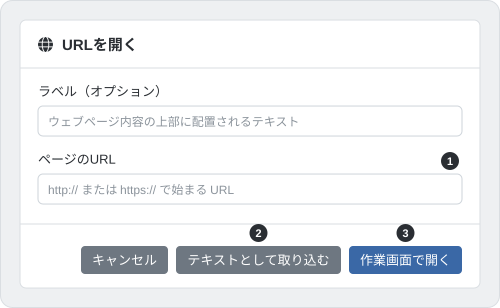
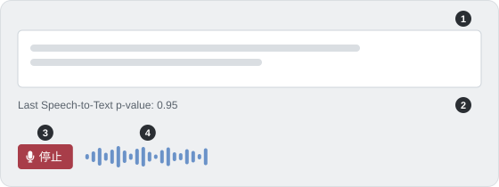

# メッセージ入力

サーバーを起動し、アプリを選んで設定した後に **セッションを開始** ボタンをクリックすると、次の画面が表示されます。

1. **匿名化**：メッセージの中の名前を見つけ、伏せるものを選びます。[匿名化](#anonymize)を参照してください。
2. **音声入力**：声を録音し、話した内容をメッセージに書き込みます。[音声入力](#speech-input)を参照してください。
3. **送信**：メッセージを送ります。
4. **クリア**：入力欄を空にします。

文書や Web ページのテキストは、[作業画面](web-interface.md#work-screen)から読み込みます。[文書ファイルからのテキスト読み込み](#reading-text-from-document-files)と [URL を開く](#reading-text-from-urls)を参照してください。AI に渡すファイルも作業画面に置きます。[AI に渡すファイル](#files-for-the-ai)を参照してください。

テキストエリアにメッセージを入力し、**送信** ボタンをクリックすると、メッセージが送信されます。音声入力については下記の[音声入力](#speech-input)を参照してください。

?> 音声入力と音声合成を使って AI エージェントとのチャットをスムーズに行うには、サイドバーのインタラクションパネルで **自動音声** と **簡単送信** をオンにすると便利です。[Voice Chat](../apps/chat-apps.md#voice-chat)アプリではこれらが既定でオンです。

?> **役割** セレクタはメッセージの役割を選びます。通常は **ユーザー** を選びます。**ユーザー（過去のメッセージに追加）** と **アシスタント（過去のメッセージに追加）** は、送らずに会話にメッセージを加えます。**システム（追加の指示を提供）** は指示を加えます。詳しくは [FAQ](../faq/faq-user-interface.md) を参照してください。

1. **ユーザー**：AI に送る、ふつうのメッセージ。
2. **ユーザー（過去のメッセージに追加）**：送らずに、あなたのメッセージとして会話に足します。
3. **アシスタント（過去のメッセージに追加）**：送らずに、AI の返答として会話に足します。
4. **システム（追加の指示を提供）**：指示として会話に足します。

## AI に渡すファイル :id=files-for-the-ai

メッセージ欄は AI と言葉をやり取りする場所です。一緒に見たいファイル（画像、PDF、文書、音声、動画、MIDI）は、あなたと AI の間の机である[作業画面](web-interface.md#work-screen)に置きます。作業画面の上の **ファイルを置く** をクリックするか、作業画面にファイルをドロップしてください。ファイルは会話のフォルダに保存され、次にメッセージを送るとき、作業画面に何があり、何が見えているかが AI に伝わります。AI は、質問に必要なときにファイルを見ます。

- **画像**：AI は画像をそのまま見ます。一部を指したいときは、送る前に作業画面で印を付けます。
- **PDF と文書**：AI はその文字を読みます。ファイルを読めるモデルには、PDF 全体（OpenAI では Word・Excel・PowerPoint の文書も）がそのまま渡されます。
- **音声・動画・MIDI**（1 個 2 GB まで）：これらを分析するアプリ（Video Describer、Speech Draft Helper、Music Tutor、Music Analyst など）は、作業画面のファイルを使います。
- **新しい画像・動画・音楽の元になる画像**：画像生成のアプリは作業画面の画像を編集し、Video Generator と Music Generator は、使うよう頼んだ画像から作ります。

画像は読めるが道具を使えないモデルは、作業画面を自分で見られません。そのモデルには、メッセージを送るたびに、選んでいる項目の画像か、PDF のページの見えている部分が渡されます。

以前の会話の、ファイル付きで送ったメッセージをもう一度送るときは、そのファイルが作業画面に置かれます。

## 文書ファイルからのテキスト読み込み :id=reading-text-from-document-files

文書を[作業画面](web-interface.md#work-screen)に置き（**ファイルを置く**、または共有フォルダから開く）、その下の **本文を入力欄へ** を押すと、表示している版のテキストがメッセージの入力欄に足されます。読み込みが可能なファイル形式はPDF、Wordファイル（`.docx`）、Excelファイル（`.xlsx`）、PowerPointファイル（`.pptx`）、さまざまなテキストファイル（`.txt`, `.md`, `.html`, etc）です。置いたファイルは会話のフォルダ（`conversations/…/inputs/`）に保存されます。読み込む間にファイルが変わったときは、何も足されません。

## URL を開く :id=reading-text-from-urls

[作業画面](web-interface.md#work-screen)の上の **URLを開く** をクリックし、`http://` か `https://` で始まるアドレスを入れます。

- **作業画面で開く**：会話のブラウザーで、そのページを[作業画面](web-interface.md#work-screen)に開きます。ブラウザーの道具を持つアプリや、作業画面を見られるアプリでは、アシスタントがそこからページを読みます。
- **テキストとして取り込む**：ページの文を Markdown 形式でメッセージ欄に読み込みます。

1. ページのアドレス。
2. **テキストとして取り込む**：ページのテキストをメッセージに読み込みます。
3. **作業画面で開く**：ページを作業画面に開きます。

## 匿名化 :id=anonymize

メッセージ欄の横の **匿名化** をクリックすると、会話が送る文の中でプレースホルダーに置き換える語（名前など）を選べます。対象は文だけです。画像、ファイルの中身、コードの実行やブラウザーが読むファイルとページ、声、選んでいない名前、すでに送ったものは対象外です。[匿名化](../advanced-topics/anonymization.md)を参照してください。

## 音声入力 :id=speech-input

?> 音声入力はChrome、Edge、Safariでサポートされています。

音声入力を行う場合は、**音声入力** ボタンをクリックして音声入力を開始し、**停止** ボタンをクリックして音声入力を終了します。音声入力が終了すると、Speech-to-Text API を通じて音声がテキストに変換され、テキストエリアに表示されます。iPhone と iPad では音声入力は使えません。

[Live Conversation](../apps/chat-apps.md#live-conversation) はこの経路を使いません。テキスト入力も **音声入力** ボタンもなく、セッション中はマイクが常時ストリーミングされます。

1. 話した内容が、入力欄に書き込まれます。
2. 直前の書き起こしの信頼度。音声認識のモデルが値を返すときに表示されます。
3. 録音中は、**音声入力** のボタンが **停止** になります。クリックすると録音が終わります。
4. 声の大きさ。

値を返す音声認識モデルでは、音声入力後に **Last Speech-to-Text p-value** が表示されます。これは認識結果の信頼度を 0 から 1 の範囲で示す指標で、1 に近いほど信頼度が高いことを意味します。

## 音声認識モデルの選択 :id=speech-to-text-model-selection

Web UI の音声パネルで音声認識モデルを選択できます。複数のプロバイダーのモデルが利用可能です。一覧は[音声パネル](/ja/basic-usage/web-interface.md#speech-settings-panel)を参照してください（各モデルは、プロバイダーの API キーが設定されていると選べます）。

## リアルタイムストリーミング音声認識 :id=realtime-streaming-transcription

Speech-to-Textモデルのドロップダウンで **GPT Realtime Whisper ⚡** を選択すると、ストリーミング音声認識モードが有効になります。⚡ の記号は録音中にライブで暫定的な認識結果（partial transcript）を返すモデルであることを示します。このモデルを選択した場合、**音声入力** の挙動は通常のバッチ処理経路と次のように異なります。

- 話している間、累積された認識結果のライブプレビューが、メッセージ入力欄に**グレーの文字**として表示されます。プレビューは数百ミリ秒ごとに更新されます。
- 録音中もテキストエリアにタイピングを続けられます。グレーのプレビューはタイプしたカーソル位置の後ろに付き従う形で表示され、入力中の文字が partial で上書きされることはありません。
- **停止** をクリックすると、確定した最終認識結果が、テキストエリアにそれまで入力していた内容の末尾に追記され、グレーのプレビューは消えます。
- **簡単送信** は、最終認識結果で 1 度だけメッセージを送ります。途中の partial で送信が発火することはありません。

1. 自分で入力した文字。
2. 聞き取っている途中の文字。グレーで表示されます。
3. 録音を止めます。

**ストリーミングモードとバッチモードの使い分け。** ストリーミングモードは長い発話中に即時の視覚フィードバックを得られるため、ライブメモやディクテーションの用途に適しています。バッチ処理経路は短い発話に対しては費用効率が良く、ドロップダウン上の他のモデルはすべてこの経路を使用します。

**コストについて。** リアルタイム音声認識は OpenAI によって音声の分数単位で課金され、同社のバッチ転写よりも単価が高くなります。ドロップダウン上の他のモデルはそれぞれのプロバイダーが課金するため、現在の料金は各プロバイダーの料金ページを参照してください。

**プロバイダー対応状況。** リアルタイムストリーミング音声認識は OpenAI でだけ利用できます。ドロップダウン上の他のSTTモデルはバッチ経路を使用します。なおこの音声認識機能は、[Live Conversation](../apps/chat-apps.md#live-conversation) の speech-to-speech 会話とは別の機能です（Live Conversation は OpenAI・xAI・Gemini で利用できます）。

!> **匿名化との関係。** **音声入力** で取り込んだ音声は、選択中の Speech-to-Text モデルのプロバイダーへそのまま送られます。[匿名化](../advanced-topics/anonymization.md)が語を伏せるのは、会話が送る文の中だけです。そのプロバイダーに送りたくない語を含む音声がある場合は、音声入力ではなくテキスト入力で送ってください。

## 音声合成の再生

**再生の操作** 
AIレスポンスの **Start TTS** のアイコンをクリックすると合成音声を聞けます。**Stop TTS** で再生が止まります（アイコンにポインタを重ねると名前が出ます）。**クエリをキャンセル** を押すと、書かれている途中の応答と、その読み上げ（合成中のものを含む）が止まります。

**自動音声** 
インタラクションパネルで **自動音声** をオンにすると、AIレスポンスが自動的に読み上げられます。**簡単送信**と組み合わせると音声対話に便利です。
