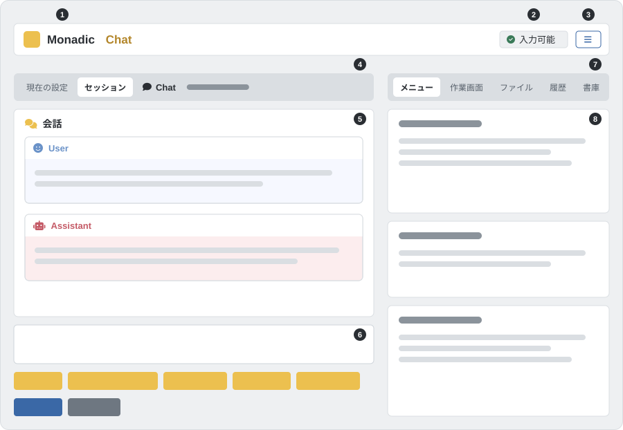
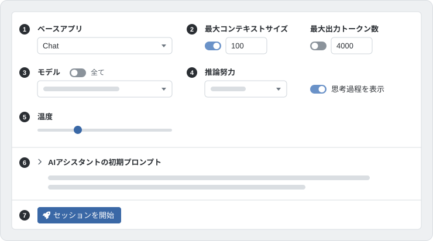
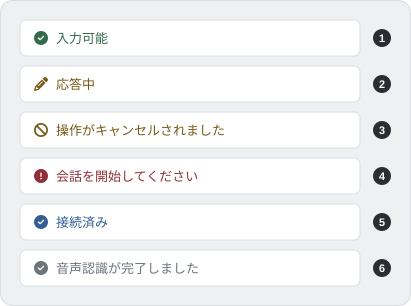
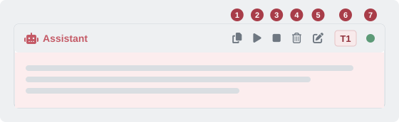
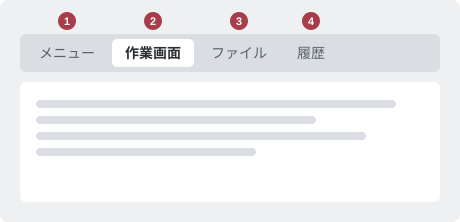
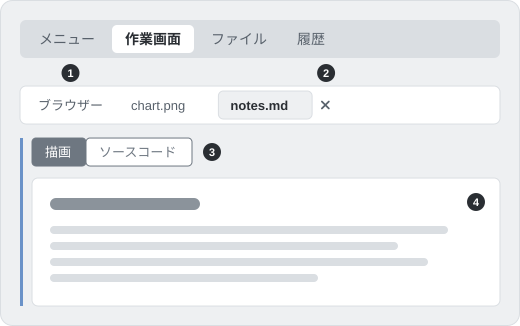
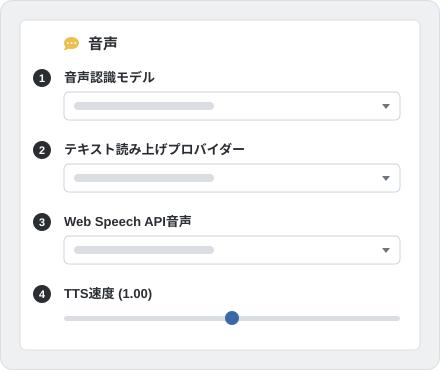

# Monadic Chat Web インターフェース

1. アプリの名前。クリックすると、会話をリセットします（今のアプリは保たれます）。
2. 状態。Monadic Chat がいま何をしているかを示します。
3. サイドバーの表示と非表示を切り替えます。
4. **現在の設定** と **セッション**、セッションのアプリとモデル。[システム設定画面](#system-settings-screen)を参照してください。
5. 会話。メッセージごとに 1 枚のカードになります。[メッセージのカード](#message-cards)を参照してください。
6. メッセージの入力欄とボタン。[メッセージ入力](message-input.md)を参照してください。
7. サイドバーのタブ：**メニュー**、**作業画面**、**ファイル**、**履歴**。
8. 選んだタブのパネル。[サイドバーのパネル](#info-panel)を参照してください。

Monadic ChatのWebインターフェースは、チャット履歴の表示エリア、メッセージ入力エリア、各種設定パネルで構成されています。

## ブラウザモード :id=browser-modes

Monadic Chat の Web インターフェースには、2 つのブラウザモードがあります。

### 内部ブラウザモード :id=internal-browser-mode

内部ブラウザモードは、Electron のデスクトップアプリの中で動き、Monadic Chat 専用のウィンドウを提供します。

内部ブラウザモードでは、右下に 5 つのボタンが表示されます（ポインタを重ねると名前が出ます）。
- **拡大**：ページを拡大します
- **縮小**：ページを縮小します
- **ズームをリセット**：拡大率を元に戻します
- **Reset All**：確認のうえ、ページが保存しているデータ（ローカルストレージとキャッシュ）を消して読み込み直し、最初のアプリの選択に戻ります。テーマ、会話の言語、メニューを出しているかどうかなどの cookie は残ります
- **Monadic Chat Console**：メインのコンソールウィンドウを表示します

### 外部ブラウザモード :id=external-browser-mode

外部ブラウザモードでは、既定の Web ブラウザが開き、ローカルのサーバー（`http://localhost:4567`）につながります。

## 言語設定 :id=language-settings

Monadic Chat情報パネルの **会話言語** で選びます。音声認識、音声合成、AI の応答の言語が決まります。57 の言語と **Automatic** を選べます。アラビア語、ヘブライ語、ペルシャ語、ウルドゥー語では、右から左（RTL）の表示になります。

言語は会話の途中でも変えられます。選んだ言語はブラウザの cookie に保存されます。画面そのものの言語は、設定ウィンドウの **UI言語** で選びます（[コンソールパネル](./console-panel.md#settings-panel)を参照）。

## システム設定画面 :id=system-settings-screen

1. **ベースアプリ**：セッションで使うアプリ。
2. **最大コンテキストサイズ** と **最大出力トークン数**：コンテキストに残すメッセージの数と、返答の長さの上限。それぞれにスイッチがあります。
3. **モデル**：使うモデル。**全て** をオンにすると、プロバイダーのモデルがすべて並びます。
4. **推論努力** と **思考過程を表示**：モデルがどこまで深く推論するかと、思考を表示するかどうか。
5. **温度** などのパラメータ。
6. **AIアシスタントの初期プロンプト**：システムプロンプト。読むことも、書き換えることもできます。
7. **セッションを開始**：この設定で会話を始めます。

セッションのアプリとモデルを選び、会話のパラメータを調整する画面です。セッションが始まると、上部のバーに **現在の設定** と **セッション** の 2 つのタブが出ます。**現在の設定** でこの画面を、**セッション** で会話を、前に見ていた位置のまま表示します。設定の下の **セッションを続行** でも会話に戻れます。履歴から会話を開いた後は、**セッション** でも **セッションを続行** と同じく会話を続けられます。バーには、アプリ、モデル、バッジも出ます。

**ベースアプリ**  
基本アプリから 1 つを選びます。アプリごとに、既定のパラメータと最初のプロンプトが違います。詳しくは[基本アプリ](./basic-apps.md)を参照してください。

**最大コンテキストサイズ**  
会話のコンテキストに残すメッセージの最大数です。欄には使われる値が表示されます。アプリが決めていなければ 100 で、決めているアプリでは切り替えがオンになります。

**最大出力トークン数**  
API の応答の最大トークン数を制限します。欄には使われる値が表示されます。選んだモデルの出力の上限、上限の決まっていないモデルでは 4000 です。推論するモデルでは上限に固定され、変えられません。

**モデル**  
使う AI モデルを選びます。選べるモデルはアプリによって違います。**全て** をオンにすると、そのプロバイダのすべてのモデルが一覧に出ます。非推奨のモデルは一覧に出ません。

**推論・思考の設定**  
高度な思考に対応したモデルで、推論の深さを調整します。推論が必須の適応型モデルは、推論の設定をオフにしても、アプリが構造化出力を使っていても推論を続けるため、これらの設定で推論のコストがなくなるわけではありません。そうしたモデルでは、推論なしを指定したアプリは、そのモデルの最も低い段階で動きます。思考の表示を隠しても、変わるのは表示だけです。表示名はプロバイダごとの呼び方に合わせて変わります（OpenAI：Reasoning Effort、Anthropic：Thinking Level、Google：Thinking Mode、xAI：Reasoning Effort、DeepSeek：Reasoning Mode）。

**思考過程を表示**  
モデルの思考・推論の過程を、各応答の中の折りたためる「Thinking Process」パネルとして表示するかどうかを切り替えます。思考に対応したモデルでだけ表示され、推論の設定と連動します。推論が「None」のときにオンにすると、そのモデルの最も低い思考の段階に上がり、推論を「None」に戻すとオフになります。最初はオンです。Ollama では、この切り替えがモデルが思考するかどうかも決めるため、オフで始まります。音声で答えるアプリ（Voice Chat、Voice Interpreter、Language Practice）は、思考を表示しない設定で始まります。切り替えのないモデルでも同じです。[Live Conversation](../apps/chat-apps.md#live-conversation) では、リアルタイムのモデルが推論の過程を出さないため、表示されません。

**パラメータ** 
Temperature、Presence Penalty、Frequency Penalty

**AIアシスタントの初期プロンプト** 
AI に送るシステムプロンプトを表示・編集します。

**AIユーザーの初期プロンプト** 
AI ユーザー機能のシステムプロンプトを表示・編集します。

**ワークフロービューア** 
選んだアプリの図を、その場で表示します（Hidden、In Panel、Floating）。入力が応答までどう流れるか、アプリがどのツール・エージェント・機能を使えるかを示します。[ワークフロービューア](./workflow-viewer.md)を参照してください。

**セッションを開始 / セッションを続行**  
新しいチャットを始めるか、今の会話を続けます。

**セッションの表示バッジ** 
上部のバーには、効いている機能のバッジが表示されます：**Web Search**、**Math**、**Knowledge Base**、今の推論の段階（オフでないとき）。Knowledge Base のバッジは、セッションが Knowledge Base を読むときに表示されます。つまり、**このセッションでナレッジベース検索を使う** がオンのときです。[Live Conversation](../apps/chat-apps.md#live-conversation) では、いくつかの設定に画面の部品がないため、それに当たるバッジは出ません。

ページの上部のバーには、会話の状態が出ます。色で状態の種類が分かります：

1. 緑：準備ができた、またはひと区切りが済んだ。
2. 黄：AI が返事を書いている。
3. 黄：何かが止まった、または注意が要る。
4. 赤：失敗した、または今はできない。
5. 青：お知らせ。サーバーとのつながりなど。
6. 灰：自分の入力のひと区切りが済んだ。

## メッセージのカード :id=message-cards

会話のメッセージは、1 つずつカードになります。アシスタントのカードの見出しには、次のボタンがあります。

1. **Copy**：メッセージのテキストをコピーします。
2. **Start TTS**：メッセージを読み上げます。
3. **Stop TTS**：読み上げを止めます。
4. **Delete**：メッセージを削除します。そのメッセージ以降をまとめて削除することもできます。
5. **Edit**：メッセージのテキストを書き換えます。
6. メッセージが属するターン。
7. メッセージが、モデルへ送るコンテキストの中にある間は緑になります。

ユーザーのカードには、**Copy**、**Delete**、**Edit** があります。

## サイドバーのパネル :id=info-panel

サイドバーの上には 4 つのタブがあります。**メニュー**には、上から次のパネルがあります。**作業画面**は下の[作業画面](#work-screen)、**ファイル**は[ファイルのタブ](#shared-folder-panel)、**履歴**は[履歴のタブ](#chat-history-panel)を参照してください（履歴は会話を残しているときに表示されます）。ページはメニューのタブで開きます。パネルの見出しをクリックすると、たたんだり開いたりできます。

タブと、会話の上の **現在の設定** のあるバーは、その下の列をスクロールしても上に残ります。会話とサイドバーの境界をドラッグすると、サイドバーの幅を変えられます。Tab キーで境界を選び、← と → でも変えられます（Home と End で最も狭く・最も広く）。幅は保たれ、どのタブでも同じです。ウィンドウが狭いときは、サイドバーと会話が全幅で入れ替わります。

**Monadic Chat情報** 
ホームページと GitHub へのリンク、今の版、**会話言語** の選択、**ウェブ検索** と **数式レンダリング** の切り替え、今の基本アプリの名前と説明、**ヘルプデータ**（Monadic Chat Help アプリが使うヘルプのデータベース。状態とインストールのボタン）、**Available Variables** の一覧。

- **ウェブ検索**：AI が Web を検索して最新の情報を得られるようにします。ツール（関数）の呼び出しに対応したモデルで使えます。[Live Conversation](../apps/chat-apps.md#live-conversation) では、代わりにアプリ自身の **検索と計算** の切り替えに含まれます（既定はオフ）。
- **数式レンダリング**：数式を KaTeX で表示します。オフのときは、モデルに数式を普通の文字か Unicode で書くよう求め、LaTeX のソースを頼んだときはコードブロックで返すよう求めます。

**AIアシスタント & AIユーザー** 
アシスタントと AI ユーザー機能が使っているモデルと、今のセッションの統計（メッセージ数とトークン数）。

**ナレッジベース** 
今の会話を Knowledge Base に **保存** し、**一覧** で中を見て、**このセッションでナレッジベース検索を使う** をオン・オフします。[Knowledge Base](../apps/knowledge-base.md) を参照してください。

**セッション操作** 
- **リセット**：アプリの選択は残したまま、今の会話を消し、パラメータを既定に戻します。ページが保存しているデータも消して最初のアプリの選択に戻るには、内部ブラウザの **Reset All** を使います
- **インポート**：JSON ファイルから会話を読み込みます。保存したセッションが非推奨のモデルを使っていて、その後継がある場合は、後継のモデルを使い、そのことを知らせます
- **エクスポート**：今の会話を JSON ファイルに保存します
- **PDF出力**：今の会話を、構文の色分けと書式を付けた PDF ファイルに保存します

**テーマ** 
System、Light、Dark。

**インタラクション** 
- **自動音声**：アシスタントの応答を、合成音声で自動的に読み上げます
- **簡単送信**：Enter キーで、または音声入力の後に **停止** をクリックすると、メッセージを送ります
- **ストリーミング中の自動スクロール**：書かれていく応答を追って表示します
- **作業画面に新しいものを表示する**：AI が新しいものを表示すると、サイドバーが[作業画面](#work-screen)に切り替わります。オフにすると、作業画面は知らせるだけで、切り替えは自分で行います
- **アシスタントから開始**：会話を始めるとき、アシスタントが最初のメッセージを書きます

これらは、音声を自分で扱う [Live Conversation](../apps/chat-apps.md#live-conversation) では表示されません。

**音声** 
下の [音声パネル](#speech-settings-panel)を参照してください。

## 作業画面 :id=work-screen

**作業画面**のタブには、今の会話で AI が使っているブラウザーの画面が、描かれるそのままに映ります。映るのはタブを表示している間で、見るだけです。AI がブラウザーを開くと（たとえば [Web Insight](../apps/analysis-apps.md#web-insight)）、サイドバーはこのタブに切り替わります。入力中のときと、**作業画面に新しいものを表示する** がオフのときは、作業画面が知らせるだけです。

1. 作業画面の項目：ブラウザー、画像、ファイル。クリックすると表示します。
2. 項目を作業画面から外します。外せる項目に付いています。
3. 項目を順に送ります。
4. **描画** と **ソースコード**：描くファイルで、描いたものとテキストを切り替えます。
5. 表示している項目。

ブラウザーは返事のあとも開いたままで、5 分間使われなければ閉じます。**リセット** でも閉じます。AI がブラウザーを開かずに撮るスクリーンショットは、作業画面の画像として表示されます。

作業画面には、AI が作った画像も表示されます（たとえば [Image Generator](../apps/image-generator.md) で生成した画像）。作業画面の項目は上に並び、クリックした項目が表示されます。ブラウザーも項目の一つです。閉じたあとも（作業画面はそのことを表示します）、× で外すまで並んだままです。画像はどれも共有フォルダの会話のフォルダにあるファイルです。作業画面にはそのパスと **別名で保存**（Web ブラウザーでは **ダウンロード**）が表示され、好きな場所に写しを保存できます。画像の項目の × を押すと作業画面から外れますが、ファイルは共有フォルダに残ります。会話には、画像のパスと **別名で保存** の 1 行が表示されます。パスをクリックすると、作業画面にその画像が表示されます。

作業画面には、[Session State](../advanced-topics/monadic-mode.md#state-notes) を保つアプリの状態ノートも表示されます。アプリが会話の中で記録したもの（Chat の話題、人物、メモなど）のページです。ページは、返答が状態を変えたときと、ターンを削除したときに作り直されます。このページが会話の作業画面の最初の項目のときは、ほかの新しいものと同じようにサイドバーが切り替わります。その後はその場で更新され、サイドバーは切り替わりません。

作業画面には、共有フォルダのファイルも表示できます。対象は画像、テキストファイル（行番号付き。長いファイルは先頭だけ）、音声、動画、PDF、Jupyter のノートブックです。PDF は 1 ページずつ表示され、‹ と ›（または ← と → のキー）でページを移り、− と + で拡大・縮小し、ページの文字を選べます。Jupyter のノートブック（`.ipynb`）は読むだけの表示で、各セルと、最後に実行したときの出力が表示されます。中のコードは実行されません。Plotly のグラフのような対話的な出力は、ノートブックにその画像が保存されているときだけ表示されます。開くには、[ファイルのタブ](#shared-folder-panel)でそのファイルをクリックします。AI も、話の中で共有フォルダのファイルを作業画面に表示できます。ファイルは写されません。開いたあとで共有フォルダのファイルが変わったり消えたりすると、作業画面はそのことを表示します。**今の内容で開き直す** を押すと、今のファイルが表示されます。**再読み込み** を押すと、表示中のファイルをいつでも読み直します。**別名で保存**（Web ブラウザーでは **ダウンロード**）を押すと、ファイルの写しを元の名前で保存します。表示中の版から変わっていないときだけ保存できます。同じファイルを開き直すと（利用者が開いても AI が表示しても）、前に表示していたものと入れ替わります。

作業画面の上の **ファイルを置く** で、コンピューターのファイルを作業画面に置けます。ファイルを選ぶか、作業画面にドロップします（一度に 5 個まで）。置いたファイルは共有フォルダの会話のフォルダ（`inputs/`）に保存され、作業画面の項目として表示されます。ファイルタブから開いたファイルと同じく、利用者と AI が一緒に見たり、指したりできます。置ける種類は作業画面が表示できるもの（上のとおり）で、1 個 64 MB までです。作業画面が表示できない種類のファイルや、中身が名前と合わないファイルは置かれず、作業画面にその理由が出ます。

会話の中の画像（送った画像や、返答が共有フォルダから表示した画像）をクリックすると、作業画面に表示されます。作業画面の画像をクリックする（または選んで Enter を押す）と、大きく表示されます。もう一度クリックするか Esc で閉じます。

一部のテキストファイルは描いて表示されます。対象は Markdown（`.md`）、Mermaid の図（`.mmd`）、表（`.csv`・`.tsv`。1 行目が見出しで、先頭の 2,000 行と 50 列を表示します）、SVG の画像、静的な HTML のページ（`.html`。スクリプトは動かず、リンクは開かず、`data:` で埋め込んだ画像だけが表示されます）、Vega-Lite のグラフ（`.vl.json`。データはファイルの中に書きます）、draw.io の図（`.drawio`。最初のページを描きます。図の中で指定された画像は読み込みません）、ABC 記譜法の曲（`.abc`。楽譜として描きます）です。ファイルの上の **描画** と **ソースコード** で、描いたものと行番号付きの文字を切り替えます。コード（`.py` や `.rb` などの拡張子で判断します）とノートブックのコードのセルには、シンタックスハイライトが付きます。描くときにネットワークから読み込むものはありません。8 MB を超えるファイルや描けないファイルは描かず、作業画面がその理由を表示します。**ソースコード** で文字を表示できます。

AI は、自分で作った表・図・グラフ・長い文書などを、会話のフォルダに新しいファイルとして書き、そのまま作業画面に表示することもできます。返答の下には、AI が作業画面に表示したファイルごとに 1 行が出ます。クリックすると、その版がもう一度表示されます（そのあとファイルが変わっていれば、作業画面はそのことを表示します）。AI が何ターンもかけて書く長い文章（[Novel Writer](../apps/writing-apps.md#novel-writer) の物語など）の節の行は、文章の全体を今の内容で、その節の位置で開きます。このような文章は、各節を AI が最後に書いた形で見せます。節を書き直したターンを削除すると、その前の版に戻ります。文章の下の **版** を押すと、その会話に残っている各節の版が新しい順に並びます。選ぶと、その版を 1 つのファイルとして開きます。

項目は来た順に一列に並びます。項目の上の ‹ と › で、また作業画面にフォーカスがあるときは ← と → のキーで移れます。

メッセージを送ると、作業画面にあるものが AI に伝わります。伝わるのは、各項目の名前・パス・状態、このタブで表示している項目、そのうち見えている部分（テキストファイルの行、PDF のページ、音声や動画の再生位置、選んでいる文字の数）です。項目の中身はこの方法では送られません。

PDF のページの一部を指せます。PDF の上の照準のボタンを押してからページの上をドラッグすると、指したい部分に半透明の印が付きます（クリックすると、その周りの小さな部分に付きます）。印をドラッグすると動き、辺や角をドラッグすると大きさが変わります。辺と角の取っ手は、マウスが印の上か近くにあるときに出ます。照準の隣のボタンで、印の形（四角か楕円）と色（橙、マゼンタ、シアン、緑、黄）を選びます。× で印を消します。画像を扱えるモデルでは、次に送るメッセージに、見えているページの部分の絵が印ごと付き、AI には何ページ目のどこに印があるかが伝わります。絵が付くのはそのメッセージだけです。もう一度送るには、印を動かすか変えます。送ったメッセージには、送った絵を示す行が付きます。押すと作業画面に表示されます。匿名化で伏せる語は、絵の中では伏せられません。絵は会話と一緒に残り、そのメッセージか会話を削除すると消えます。画像を作るアプリでは、絵は付きません。AI が PDF を見るときは、印の中の文字も渡ります。作業画面の画像にも、同じように印を付けられます。AI がその画像を見るときは、印を描き込んだ画像を見ます。

PDF のページの文字は、選んで指すこともできます。ページの文字を選ぶと、PDF の上に、選んだ文字が次のメッセージと一緒に送られることを示す札が出ます。札の × を押すと、その文字は送られません。選んだ文字は、メッセージ欄などほかの場所をクリックしても残り、送るか別の文字を選ぶまで保たれます。メッセージと一緒に、AI には選んだ文字（1 行にまとめたもの）とそのページが、書いた文の後に引用の形で伝わります。送るのは 2,000 文字までで、切ったときはそのことも AI に伝わります。匿名化で伏せる語は、メッセージと同じく、選んだ文字の中でも伏せられます。送ったメッセージには、送った文字を示す行が付きます。押すと文字が表示されます。どのモデルでも使え、印と選んだ文字を同じメッセージで送ることもできます。

AI は、必要なときに、このタブで表示している項目を見ることもできます。画像はそのまま、テキストファイルはテキストとして見ます。テキストは、画面に見えている行とその前後の数行か、ファイルの先頭からです（長いファイルは途中で切ります）。PDF は、ページの見えている部分（タブが描いたものの画像）と、そのページ全体の文字と、その中であなたが選んだ文字を見るか、先頭 100 ページの文字を見ます。見えている部分は、AI があなたのタブに尋ね、作業画面がそのファイルを表示しているときにタブが答えます。PDF の文字は Python のコンテナで読みます。コンテナが動いていないときは、AI に渡るのは画像と選んだ文字だけです。ブラウザーは、ウィンドウに見えている部分の画像（ページ全体ではありません）と、ページのタイトルと、アドレス（`?` と `#` から後を除いたもの）を見ます。これはアプリのコンテナで動かしているときだけで、開発のためにサーバーをホストで動かしているときは見られません。見るのは、メッセージを送ったタブで選んでいる項目の、その時点の内容です。ファイルが変わっていたり、別の項目を選び直していたりしたときは、ほかのものを代わりに見ることはせず、何も見ません。作業画面がファイルを描いて表示しているときは、AI にはどの行が見えているか分かりません。代わりにファイルの文字を先頭から読み、それが描いたものではなく文字であることも AI に伝わります。音声・動画は見られません。文字の会話で見られるのは、画像を読めるモデルのときだけです。[Live Conversation](../apps/chat-apps.md#live-conversation) では、どのモデルでも見られ、画像を読めないモデルは文字だけを受け取ります。返答の下に、AI が見たもの（名前・版・行）と、それが AI の提供元に送られたかを示す行が出ます。返答が終わらなかったときは、あなたのメッセージの下に出ます。会話と履歴に残るのはこの行で、見た中身は残りません。要求を送る前に会話がリセットされたときは、何も送られません。

AI が新しいものを表示すると、作業画面はそれを表示します。メッセージを入力している間と、インタラクションパネルの **作業画面に新しいものを表示する** をオフにしているときは切り替わりません。自分で開いたものは必ず表示されます。サイドバーを隠しているときは隠したままです。ほかのタブを表示している間に新しいものが来たり項目が更新されたりすると、**作業画面** のタブに点が付き、開くまで残ります。作業画面に置ける項目は 8 つまでで、新しいものが来ると、いちばん古い項目が作業画面から外れます（ファイルは共有フォルダに残ります）。開いているページ（Web ブラウザーのタブ）で表示中の項目、最新の画像、開いているブラウザーは外れません。すべての項目が外れない状態では、どれかを × で外してから開いてください。そのときに開いたブラウザーは、項目を一つ外すと表示されます。

## 音声パネル :id=speech-settings-panel

1. **音声認識モデル**：話した内容を文字にするモデル。
2. **テキスト読み上げプロバイダー**：返答を読み上げるサービス。
3. 選んだプロバイダーの声。
4. **TTS速度**：読み上げの速さ。

!> **注意:** 音声の機能を使うには、Google Chrome、Microsoft Edge、Safari のいずれかのブラウザが必要です。

このパネルは [Live Conversation](../apps/chat-apps.md#live-conversation) では使いません。このアプリでは、専用の操作欄で声と速度を選べます。

**音声認識モデル** 
音声認識のモデルを選びます。OpenAI、Gemini、ElevenLabs、Cohere、Mistral、xAI のモデルがあります。

**テキスト読み上げプロバイダー** 
音声合成のプロバイダを選びます（OpenAI、ElevenLabs、Gemini、Mistral、Grok TTS、Web Speech API）。

**エクスプレッシブスピーチ** 
自動音声がオンで、選んだ音声合成のプロバイダがエクスプレッシブスピーチに対応しているとき（指示に対応した OpenAI の音声合成モデル、xAI Grok、ElevenLabs v3 と v4、Gemini TTS）、プロバイダの選択の下に **エクスプレッシブスピーチ** のバッジが出ます。このとき音声には、返答に合った口調・間・笑いなどが加わります。チャットには、書かれたとおりの返答が表示されます。バッジにポインタを重ねると説明が出ます。

Gemini TTS では、文にない「Oh,」のような言葉や笑いが音声に入ることがあります。語学の教材など、文のとおりに読む必要があるときは、自動音声をオフにするか、エクスプレッシブスピーチに対応していないプロバイダを選んでください。

**Text-to-Speech Voice** 
音声合成の声を選びます。選べる声はプロバイダによって違います。

**TTS速度** 
合成音声の再生速度を調整します（0.7〜1.2）。

## 履歴のタブ :id=chat-history-panel

Monadic Chat は、会話をこのコンピュータの `~/monadic/state` に残します。共有フォルダの外です。会話は、あなたが最初にメッセージを書いたときから残り、新しいメッセージのたびに更新されます。

会話について残すものは、メッセージの文面、アプリ、モデル、システムプロンプト、主な設定（推論の強さ、文脈の大きさ、Web 検索、会話の言語など）と、[Session State](../advanced-topics/monadic-mode.md) です。画像、添付したファイルの中身、思考の過程、ツール呼び出しの記録は残しません。Monadic Chat に設定してある API キーと 1Password の参照は、会話の名前も含めて、残すものから取り除きます。それ以外の秘密（パスワードや、Monadic Chat が持っていないキーなど）は、会話に書いたとおりに残ります。会話に貼り付けないでください。

コンピュータのバックアップ（Time Machine など）や、`~/monadic` を含む同期のサービスには、履歴も写ります。Actions メニューの **ドキュメントDBをエクスポート** には、履歴は含まれません。

**履歴** のタブには、残している会話を、最近の動きがあった順に表示します。会話を残しているときに表示されます。

- 検索欄で、会話の名前と、会話の中の言葉から探せます。**さらに表示** で古い会話を足せます。
- 各会話には、名前（無ければ最初の話題）、アプリ、メッセージ数、最後に新しいメッセージがあった時刻を表示します。
- 会話をクリックすると、その会話をメッセージ・アプリ・モデル・設定とともにこのタブで続けられます。アプリのツールは新しく用意され、続けた会話では自動音声と「アシスタントから開始」はオフになります。このタブにあった会話は履歴に残ります。ウィンドウが狭いときは、続けた後に会話が表示されます。
- 会話の **⋯** のボタンには、**続ける**、**名前**、**履歴から削除** があります。**名前** で、会話に名前を付けます（120 文字まで）。Enter で保存し、Esc で取り消します。**履歴から削除** は、その行で確かめてから消します。消した会話は Monadic Chat から読めなくなり、その会話の作業画面（項目と、メッセージと一緒に送った絵）も一緒に消えます。その会話が共有フォルダに作ったファイル、書き出したファイル、コンピュータのバックアップは消えません。
- タブで開いている会話には「タブで開いています」と表示し、別のタブからは続けることも消すこともできません。続けるか消すには、その会話を開いているタブで新しい会話を始めてください。

## ファイルのタブ :id=shared-folder-panel

**ファイル** のタブには、共有フォルダ（`~/monadic/data`）の中身を、一度に 1 つのフォルダずつ表示します。フォルダをクリックすると中に入り、上部のパスか上向き矢印のボタンで戻れます。ファイルをクリックすると、[作業画面](#work-screen)で開きます（画像、テキストファイル、音声、動画、PDF、Jupyter のノートブック）。それ以外の種類のファイルは、クリックすると選択されます。

会話と作業画面では、共有フォルダのパスをファイル名だけで、点線の下線を付けて表示します。ポインターを重ねると、パス全体が表示されます。同じ名前のファイルが 2 つあるときは、フォルダ名を添えて表示します。ページからコピーした文字とモデルに送る内容には、パス全体が入ります。コードブロックの中のパスと、`Anonymize` で隠す語を含むパスは、書かれたとおりに表示します。

各項目には、名前・更新日時・大きさ・内容が表示されます。

- **内容**は、Monadic Chat の記録があるもの（会話ごとのフォルダ、`pub_` で始まる名前のファイル）は記録によって、それ以外は名前だけから示し、「（名前から推定）」と付けます。名前からは、そのファイルがまだ必要かどうかは分かりません。ページで再生する動画と字幕は、Monadic Chat が共有フォルダの外に保管します。共有フォルダにある `pub_` で始まる名前のファイルは使われていないので、ごみ箱に移してかまいません。
- Monadic Chat やあなたの設定が読み込むもの（あなたのスクリプト・アプリ・ヘルパー、Docker サービス、文書データベースのバックアップ）には、鍵のアイコンと理由が表示されます。
- タブで開いている会話のフォルダには「使用中」と表示されます。
- Monadic Chat 自身の試験の実行で作られたファイル（名前が `monadic-test-…` のもの）には「試験の実行で作られたもの」と、以前の試験の実行が使っていた名前のものには「試験の実行で残ったものの可能性」と表示されます。
- リンクはリンクとして表示し、たどりません。
- システムが置くファイルは表示しません。OS や Jupyter がファイルのそばに置くもの（`.DS_Store`、`Thumbs.db`、`.ipynb_checkpoints` など）と、共有フォルダの一番上にある Monadic Chat 自身の隠しファイルです。
- フォルダのサイズはバックグラウンドで計算し、終わったものから表示します。「≥」の付いた大きさは、一部だけを数えたものです（とても大きいフォルダや、一部を読めないフォルダ）。

検索欄で名前から探し、横のメニューで名前・更新日時（**新しい順**）・大きさ（**大きい順**）に並べ替えられます（並べ方は次回も保たれます）。絞り込みのボタンで、項目の種類や、最近 30・90・365 日に更新されていないもので絞り込めます。絞り込んでいる間は、一覧の上の帯にそのことが表示され、外すボタンがあります。**さらに表示** で次の 50 件を足します。一覧の上の 1 行には、読み込み中であること、フォルダが空のときや合う項目がないとき、失敗したこと、コピーしたこと、ゴミ箱へ移動した結果を表示します。結果は閉じるまで残ります。

項目は、その前のボックスで選択できます。Shift を押しながらクリックすると範囲を、Cmd/Ctrl を押しながら名前をクリックすると、開かずに選択できます。一覧では ↑ ↓ で移り、Shift+↑ ↓ で選択を広げ、スペースキーで選択し、Enter で開き、Cmd/Ctrl+A で表示中をすべて選択し、Esc で選択を解除します。一覧の上の選択のボタンには、**表示中をすべて選択**、**ゴミ箱に移せるものをすべて選ぶ**（検索と絞り込みに合う項目すべて。表示していないものも含む）、**テストのファイルを選択**、**一括選択でフォルダを除く** があります。選択している間は、一覧の上の帯に件数と合計のサイズが表示され、チャットでそのファイルを指すときのパス（`/monadic/data/…`、1 行に 1 つ）をコピーするボタン、ゴミ箱へ移すボタン、選択を解除するボタンがあります。

項目の **⋯** のボタン（一覧ではメニューキーか Shift+F10 でも）には、その項目でできることがあります。開く、パスをコピーする、ファイルマネージャーで表示する（デスクトップアプリ。フォルダもファイルも開きません）、ゴミ箱へ移す、です。

デスクトップアプリでは、項目をシステムのゴミ箱へ移動できます。移すのは Monadic Chat が許す項目だけです。理由があって残しておく項目と、タブで開いている会話のフォルダとその中身は、選択はできますが（パスのコピーのため）移されません。選択のうち移せないものの件数は帯に表示されます。ブラウザーではボタンは表示されますが使えず、そのことが帯に表示されます。件数と先頭の項目を示すダイアログで確認します。ゴミ箱へ移動した項目は、ゴミ箱から元に戻せます。

?> Monadic Chat は、共有フォルダに小さな隠しファイル `.monadic-shared-root` を置きます。削除しないでください。これがないと、ファイルマネージャーでの表示も、ゴミ箱への移動もできません（一覧は表示されます）。

## AIユーザー機能 :id=ai-user-feature

AIユーザー機能は、AIが会話の中でユーザーの応答をシミュレートして生成する機能です。AIがユーザーの役割を演じ、会話の文脈に基づいてフォローアップメッセージを作成することで、自動的な会話の継続が可能になります。

### 仕組み

メッセージ入力エリアの AI User のプロバイダの選択の隣にある **実行**（再生のアイコン）をクリックすると、選択したAIプロバイダーがユーザーとしての応答を生成します。AIは直近の会話履歴を分析し、人間のユーザーが発する可能性のある自然なフォローアップの質問やコメントを生成します。

### 設定

**AI User Provider** 
メッセージ入力エリアで、シミュレートされたユーザー応答を生成するAIプロバイダーを選択します。これはメインの会話で使用するAIプロバイダーとは異なるものを選択できます。利用可能なプロバイダーは、設定済みのAPIキーに依存します（OpenAI、Anthropic、Gemini、Cohere、Mistral、DeepSeek、Grok）。

**AIユーザーの初期プロンプト** 
AIがユーザー応答を生成する際のガイドとなるシステムプロンプトをカスタマイズできます。シミュレートされたユーザーの性格、注目する分野、応答スタイルを調整するために変更できます。

### ユースケース

- **ハンズフリー会話**: タイピングなしで会話を続行、マルチタスク中に便利
- **探索**: AIにフォローアップの質問を自動生成させてトピックを探索
- **テスト**: アシスタントがさまざまなユーザー入力をどのように処理するかをテスト
- **学習**: あるトピックについてAIがどのように自然に会話を続けるかを観察

### ヒント

- AIユーザーは応答生成時に直近5件のメッセージ履歴を考慮します
- 最良の結果を得るには、AIユーザーを使用する前に明確なトピックまたは質問から始めてください
- AIユーザーを連続して複数回使用することで、自動化された長い会話を作成できます
- 生成されたメッセージは入力フィールドに表示されるため、送信前に確認・編集できます

## レスポンスの検証 :id=response-verification

各AI応答の下に **この回答を検証** アクションがあります。クリックすると、設定済みの他プロバイダーからなる多様なパネルに同じ質問を — その回答が書かれたときと同じ会話文脈で — 投げ、各モデルがどれだけ独立して一致するかを判定して回答をクロスチェックします。独立したモデル間の一致は信頼のシグナルです。多様なプロバイダーが同じ答えに収束すれば正しい可能性が高く、ばらつけばより慎重な確認が必要です。

### 仕組み

- 質問（と直前までの会話文脈）が、設定済みの異なるプロバイダーからなるパネル（各々コスト効率のよいモデル）に送られます。
- 別のモデレーターモデルがパネルの回答を — 匿名化された状態で、特定のプロバイダーを贔屓できないように — 読み、どれだけ強く一致するかを報告します。
- 結果は応答の下に表示されます: 信頼度、パネルが一致した点、相違点、各メンバー自身の回答（展開可能）、モデレーターのモデル、そして元の回答が裏付けられたか異議があるか。
- 検証の実行中はスピナーが表示され、完了するまで他の操作は一時停止されます。

### 信頼度レベル

- **高 (High)** — パネルが強く一致。推奨: 信頼 (trust)。
- **中 (Medium)** — 部分的な一致。推奨: 要確認 (verify)。
- **低 (Low)** — パネルが割れている。推奨: 要再検討 (escalate)。
- 元の回答がパネルの合意と食い違う場合、パネル内部の一致度に関わらず「異議あり (disputed)」と示されます。

### 要件と制限

- 意味のあるクロスプロバイダー検証には **2つ以上の設定済みプロバイダー** が必要です。1つのみの場合は、より弱い自己整合性シグナル（明示的にラベル付き）にフォールバックし、出力を変化させられないモデルでは偽の自信を示す代わりに「一致を測定できない」と報告します。
- 検証は複数のモデル呼び出し（パネル＋モデレーター）を行うため、追加のトークンを消費します。

### 永続化

- 検証結果は、ページの再読み込み時、および会話を JSON でエクスポート/インポートしたときに保持されます。
- 会話を Knowledge Base に保存する場合や PDF にエクスポートする場合には **含まれません** — 回答に対する論評であって、会話の内容そのものではないためです。

同じ機能は `monadic_confidence` ツールとして外部エージェントからも利用できます。[MCP連携](/ja/advanced-topics/mcp-integration.md) を参照してください。
